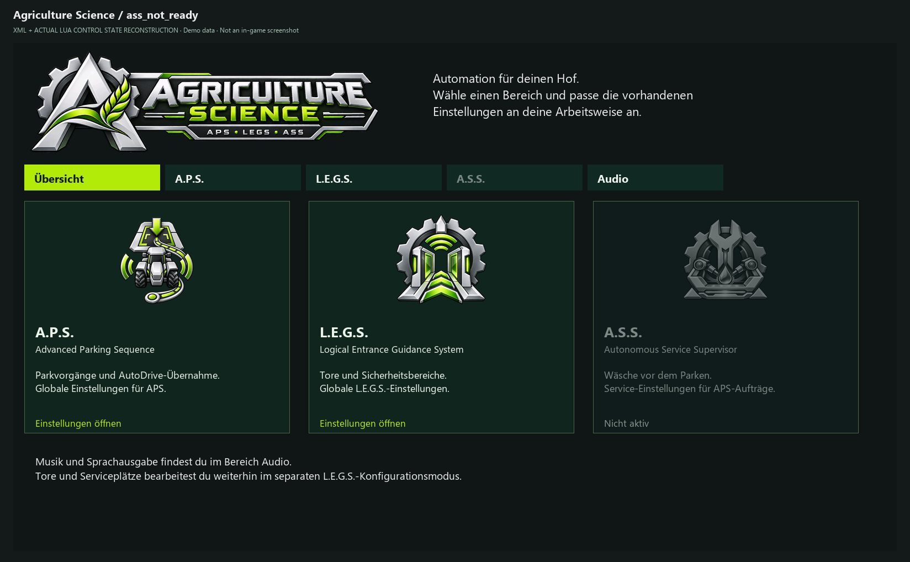

# Installation und Aktualisierung – Agriculture Science

> **Zu den Bildern:** Codebasierte UI-Abbildungen vom 29.10.2026 mit Beispieldaten, keine Ingame-Screenshots. Engine-Schrift, Farben und native Fenster können abweichen. Die Bildaufteilung der Settings ist für die Dokumentation paginiert; im Spiel wird gescrollt. [Bildnachweis und Grenzen](../UI_CATALOG.md).

> **Stand 29.10.2026:** Dokumentation eines Testkandidaten, keine Veröffentlichung im neuen Repository. Der jüngste SmartGate-Zielidentitätsfix ist **lokal installiert, aber noch nicht im Spiel oder auf Dedi abgenommen**. [Build-Matrix](../BUILD_STATUS.md).

## Was gehört zusammen?

Es gibt **zwei** Mod-ZIPs: `FS25_APS_AgricultureScience.zip` (APS **und** ASS) und `FS25_SmartGate_AgricultureScience.zip` (LEGS). Für automatisierte Fahrten wird AutoDrive benötigt (Referenz **3.0.1.4**, nicht mitgeliefert). APS-Parken und grundlegende SmartGate-Tore funktionieren getrennt; **ASS benötigt beide Mods**. Courseplay ist optional.

## Singleplayer: Neuinstallation

1. LS25 vollständig beenden. **Savegame und bisherigen Mods-Ordner sichern.**
2. Nur ein tatsächlich bereitgestelltes äußeres Paket entpacken; andernfalls die beiden einzelnen ZIPs verwenden. Keine GitHub-Quellarchive als Spielmods einsetzen.
3. Die **inneren Mod-ZIPs unverändert** in den aktiven Mods-Ordner kopieren. ZIPs nicht entpacken; doppelte Versionen und gleichnamige entpackte Modordner vermeiden.
4. AutoDrive separat installieren, im Spielstand die benötigten Mods aktivieren und AutoDrive-Zielnetz prüfen.
5. Im gemeinsamen **Agriculture Science**-Reiter verfügbare Bereiche APS, LEGS, ASS und Audio prüfen; nicht vorhandene Modulansichten können gesperrt sein.
6. Für Services zunächst in LEGS die passende native Servicequelle und Bay konfigurieren, anschließend ASS-Einzeldienst testen. [ASS-Tutorial](TUTORIAL_ASS.md).

## Dedicated Server

1. Server stoppen, Savegame, aktuelle Mod-ZIPs und die **serverseitige `smartGate.xml`** sichern.
2. Dieselben beiden ZIPs und kompatiblen AutoDrive-Build auf **Server und allen Clients** bereitstellen.
3. **SHA-256 statt bloßer Versionsanzeige vergleichen:** Alle Kandidaten melden Modversion `1.0.0.0`, haben aber verschiedene Inhalte. Siehe [Build-Matrix](../BUILD_STATUS.md).
4. Farmberechtigungen, native Quellen, Bay-Reservierungen und AD-Netz prüfen. Änderungen zuerst im SP testen. Eine vollständige Abnahme des aktuellen Pakets auf Dedi liegt nicht vor.

## Bestehende Installation aktualisieren

1. Sicherungen herstellen und bestehende Version/Hash dokumentieren.
2. Neue Mod-ZIPs paarweise kompatibel auswählen; alte Dateien nicht parallel stehen lassen.
3. Den Spielstand laden und vorhandene Bereiche, Tortrigger, Servicequellen sowie AD-Ziele kontrollieren.
4. **Beim SmartGate-Zielidentitätskandidaten vom 29.10.2026 und seinem Nachfolger:** Jede alte Bay mit positiver AD-Zielnummer einmal neu aus der aktuellen Zielauswahl wählen; die neue Identität benötigt Name und Position. [Migrationsanleitung](MIGRATION_AD_TARGETS.md). Nicht automatisch auf eine mögliche Fehlzuordnung vertrauen.
5. Ein einzelnes Fahrzeug und eine Bay testen, bevor automatische Flottenabläufe aktiviert werden.

## Externe Stimmen und Musik

Eigene Voicepacks liegen außerhalb der Mod-ZIP unter `modSettings/APS_sounds/voices/`. Vor dem Austausch eigene Bearbeitungen sichern. Vorhandene externe Default-Dateien werden durch Updates nicht automatisch überschrieben. Private Voicepacks sind keine Standardbestandteile des öffentlichen Pakets.

## Achtung

Keine generelle LS25-Mindestpatchversion aus dem dokumentierten Teststand `1.25.0.0` ableiten; Dedi-/MP-Abdeckung ist noch unvollständig. Der neueste SmartGate-Hotfix darf erst nach eigener Installation und Ingame-Prüfung als funktionierend beschrieben werden.

*Agriculture-Science-Übersicht mit drei verfügbaren Modulkarten.*

Gesperrte Karten bedeuten, dass Modul, Sitzungsaktivierung, Abhängigkeiten oder registrierte Ansicht fehlen können. Die konkrete Meldung beachten.

*Beispiel einer gesperrten A.S.S.-Karte bei nicht bereitgestellter Ansicht.*
