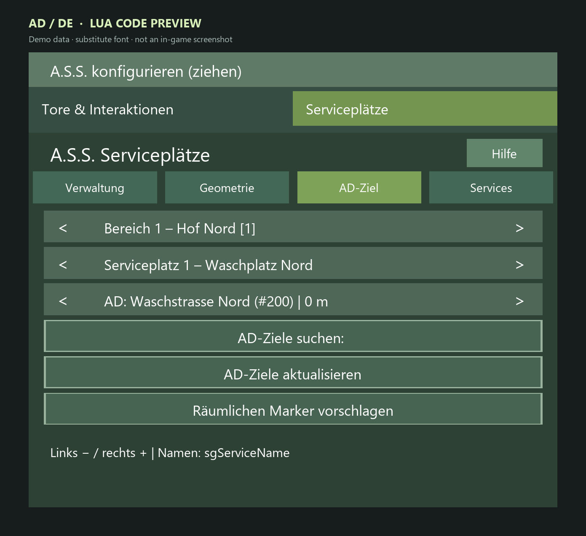

# Migration: AD-Serviceziele nach Markeränderungen

> **Zu den Bildern:** Codebasierte UI-Abbildungen vom 29.10.2026 mit Beispieldaten, keine Ingame-Screenshots. Engine-Schrift, Farben und native Fenster können abweichen. Die Bildaufteilung der Settings ist für die Dokumentation paginiert; im Spiel wird gescrollt. [Bildnachweis und Grenzen](../UI_CATALOG.md).

> **WICHTIG – Stand 29.10.2026:** Die Zielidentität ist auch im Nachfolger `SG_InteractionDescription_20261029` enthalten. Dieser wurde lokal installiert und per SHA-256 geprüft; eine Ingame-/Dedi-Bestätigung des neuen Fixes liegt noch nicht vor. Eine lokale Installation bedeutet keine Aktualisierung eines entfernten Servers.

## Hintergrund

Bisher war die AD-Zielnummer in einer Service-Bay eine **veränderliche Listenposition**, keine beständige Zielidentität. Wird ein **früherer Marker gelöscht**, können spätere Indizes nachrücken. Die alte Bay-Zahl bleibt dann stehen und verweist womöglich auf einen ganz anderen Ort. In einem Nutzerfall führte Ziel `320` zu einem inzwischen so benannten **Erbsenlager**. Die technische Indexlücke wurde anhand lesend geprüfter echter AD-Funktionen reproduziert; **welcher konkrete Edit** im Spielstand die ursprüngliche Abweichung verursachte, ist nicht bewiesen. Reines Hinzufügen hängt im untersuchten Fall an und verschob keine vorhandenen Indizes.

## Was der neue Kandidat vorsieht

- Bewusstes Auswählen speichert **Index, Name und X/Z-Koordinaten**.
- Abgleich **alle zehn Sekunden** und **vor Verwendung** gegen aktuelle AD-Zieldaten.
- Bei abweichendem Index nur eindeutige Wiederauffindung über **passenden Namen und Position**.
- Fehlendes, mehrdeutiges, umbenanntes oder verschobenes Ziel → **UNKNOWN**, keine unkontrollierte Fahrt.
- Verlust der Zielidentität während einer Fahrt widerruft die Lease und führt in bestehenden **Cleanup/Abbruch**, statt heimlich zu einem anderen Ziel umzuleiten.
- Veraltete Clientauswahl wird serverseitig abgelehnt; Korrektur erzwingt keinen synchronen Extrasave.

## Einmalige Neuzuordnung nach Installation des Kandidaten

1. Server/Spiel schließen und Spielstand inklusive **`smartGate.xml`** sichern.
2. Sicherstellen, dass **Server und alle Clients denselben neuen SmartGate-Build** verwenden, wenn dessen Test freigegeben wird.
3. Spiel laden und die jeweilige **A.S.S.-Service-Bay** in L.E.G.S. öffnen.
4. Auf der Seite **AD-Ziel** die aktuelle Zielliste aktualisieren.
5. **Jedes bereits gespeicherte positive Bay-Ziel einmal bewusst neu auswählen.** Nur so werden Name und Position verlässlich erfasst. Nicht automatisch den eventuell schon falschen alten Index übernehmen.
6. Prüfen, dass der gewählte Marker tatsächlich die **richtige Bay** anfährt; ein Marker allein ist kein Routentest.
7. Änderungen speichern, Testfahrt mit einem einzelnen geeigneten Fahrzeug ausführen und Logs kontrollieren.
8. Danach Marker **löschen, umbenennen oder verschieben** nur mit Bewusstsein, dass dies gewollt als **UNKNOWN** blockieren kann; das Ziel dann neu auswählen.

**Unverändert bei der Migration:** Provider-/Bay-Bereiche, Quellen, Maße und Fähigkeiten bleiben erhalten; es ist keine komplette Neukonfiguration nötig.

*AD-Ziel der ausgewählten Bay: manuelle Auswahl, Suche, Aktualisierung und räumlicher Vorschlag.*

## Bei Problemen

- UNKNOWN und verweigerter Dispatch sind **Sicherheitsreaktionen**, kein Beweis für einen weiteren Wegpunktfehler.
- Prüfen: richtiger Build/Hash, tatsächlich neu gewähltes Ziel, aktuelle Name/Position, Eindeutigkeit, AutoDrive-Route.
- Bei Abbruch während Fahrt aktuelle Auftrag-/Lease-Daten und bereinigten Serverlog sichern.
- Keinen bestimmten historischen AD-Edit als Ursache behaupten, solange er nicht nachgewiesen ist.

Siehe [Buildstatus](../BUILD_STATUS.md) · [Fehlerbehebung](TROUBLESHOOTING.md).

