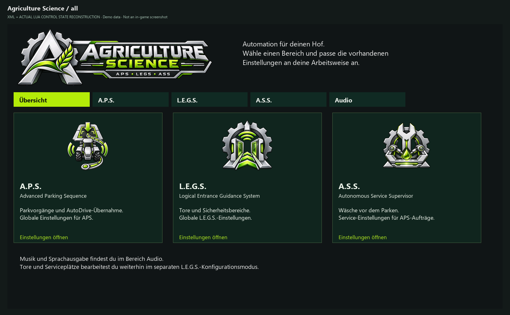
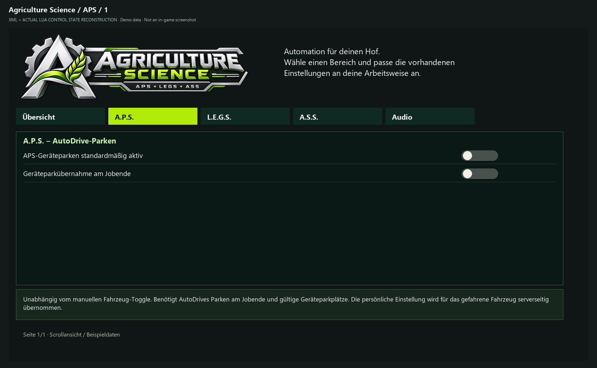
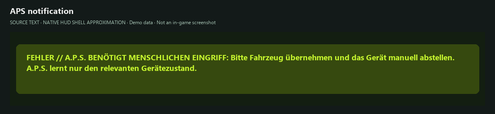

# Tutorial: A.P.S. – Advanced Parking Sequence

> **Zu den Bildern:** Codebasierte UI-Abbildungen vom 29.10.2026 mit Beispieldaten, keine Ingame-Screenshots. Engine-Schrift, Farben und native Fenster können abweichen. Die Bildaufteilung der Settings ist für die Dokumentation paginiert; im Spiel wird gescrollt. [Bildnachweis und Grenzen](../UI_CATALOG.md).

APS organisiert das Parken eines Zugfahrzeugs und von **bis zu zwei geeigneten direkt angehängten Geräten**. AutoDrive übernimmt die Navigation; APS kontrolliert Reihenfolge und native Abkuppelbedingungen. A.S.S. ist in derselben Mod-ZIP enthalten, Servicefunktionen benötigen zusätzlich LEGS.

*Agriculture-Science-Übersicht mit drei verfügbaren Modulkarten.*

## 1. Vorbereitung

1. Stelle eine tatsächlich befahrbare **AutoDrive-Route** zum Fahrzeugparkplatz und zu jedem vorgesehenen Geräteparkplatz her.
2. Weise dem Zugfahrzeug und allen zu parkenden Geräten die passenden **AD-Parkziele** zu. APS erfindet keine Marker bei fehlender Zuordnung.
3. Starte zum Kennenlernen mit einem normalen Traktor und **einem** angehängten Gerät. Komplexe Gespanne, gefaltete Geräte und Drehschemel erst später testen.
4. Öffne den gemeinsamen Reiter **Agriculture Science → A.P.S.** und aktiviere die gewünschten Optionen für manuelle beziehungsweise unterstützte Jobende-Abläufe.

*Globale A.P.S.-Optionen für Geräteparken und Jobende-Übernahme.*

## 2. Parken starten

- Die standardmäßig beschriebene, **frei belegbare Aktion** ist **Strg+P** zum Starten. Nicht als garantiertes Start-/Abbruch-Toggle verstehen; individuell belegte Tasten können abweichen.
- Bei der vorhandenen AutoDrive-HUD-Integration gibt es einen Abbruchpfad über **Umschalt + Rechtsklick** auf den erweiterten Parkbutton, sofern keine konkurrierende HUD-Funktion aktiv ist.
- APS prüft Ziele und Zustand, fährt zum ersten Geräteparkmarker, kuppelt unter den **nativen Spielbedingungen** ab, bearbeitet gegebenenfalls das zweite geeignete Gerät und fährt danach zum Fahrzeugparkziel.
- Bei lernpflichtigen Gerätekonfigurationen dem vorgesehenen Teach-/Lernablauf folgen; nicht jedes Modgerät ist automatisch kompatibel.

*Hinweis bei notwendigem manuellen Lernschritt; angenäherte Meldungsfläche.*

**Bildlücke:** Die AD-Parkzielzuweisung und der erweiterte AD-Parkbutton sind hier nicht abgebildet. Dafür fehlen überprüfte native Screenshots; die Meldungsabbildung ersetzt keinen vollständigen Lernablauf.

## 3. Waschen und weitere Services vor dem Parken

1. Zuerst ein **funktionierendes reines Parkmanöver** bestätigen.
2. In **LEGS** eine geeignete Bay mit Quelle, Geometrie und AD-Ziel konfigurieren.
3. Im **A.S.S.**-Bereich WASH beziehungsweise die gewünschten automatischen Bedarfsoptionen aktivieren. Automatische REPAIR-/REFUEL-Prüfungen und AD-Taskwechsel sind **standardmäßig AUS**.
4. Schwellen korrekt lesen: Reparatur basiert auf Schaden, die Anzeige kann aber den **verbleibenden Fahrzeugzustand** darstellen (z. B. intern 20 % Schaden = 80 % Zustand). Tankgrenze ist verbleibender Füllstand.
5. Erneut APS starten; ein unterstützter Service wird eingeschoben und nach gesicherter Ausführung zum Parkablauf zurückgegeben. Bei fehlender Bay, falschen Quellen oder AD-Fehlern nicht von erfolgreichem Service ausgehen.

## 4. Test und Diagnose

Im SP ohne Fahrer beobachten: Gerät wird wirklich abgestellt, native Abkuppelbedingungen erfüllt, nächste AD-Fahrt startet und endet am Fahrzeugmarker. Mit angehängten Gewichten und mehreren Einheiten separate Tests durchführen.

**Experimenteller Resume-Zusatz:** Die installierte APS-Variante enthält einen Zusatz gegen gelegentliche Stillstände nach Drehschemel-Abkuppeln/Service. Positive SP-Läufe liegen vor, aber **keine allgemeine Dedi-Freigabe**. Der kanonische APS-Export enthält den Zusatz nicht.

Bei unerwartetem Halt Fahrzeug, Attachments, AD-Route, Auftrag und **aktuellen Serverlog** dokumentieren. Ein älterer Fall nicht fortgesetzten Parkens nach einer Servicewarnung gilt nicht pauschal als behoben.

Weiter: [ASS](TUTORIAL_ASS.md) · [Troubleshooting](TROUBLESHOOTING.md).

