# Tutorial: A.S.S. – Autonomous Service Supervisor

> **Zu den Bildern:** Codebasierte UI-Abbildungen vom 29.10.2026 mit Beispieldaten, keine Ingame-Screenshots. Engine-Schrift, Farben und native Fenster können abweichen. Die Bildaufteilung der Settings ist für die Dokumentation paginiert; im Spiel wird gescrollt. [Bildnachweis und Grenzen](../UI_CATALOG.md).

A.S.S. ist **in der APS-ZIP enthalten**, nicht eigenständig zu installieren. Für den Servicebetrieb müssen **APS und L.E.G.S./SmartGate** geladen sein. AutoDrive übernimmt Fahrten, L.E.G.S. liefert die Infrastruktur und A.S.S. koordiniert die native Ausführung. A.S.S. ist **kein** eigenes Tank- oder Finanzsystem.

## 1. Eine Service-Bay anlegen

1. Mit **Strg+G** den separaten Konfigurationsmodus öffnen und **Serviceplätze** wählen. Globale Optionen und Serviceanfragen liegen im gemeinsamen Reiter **Agriculture Science → A.S.S.**. Der Inworld-Editor verwendet die Bereiche **Verwaltung / Geometrie / AD-Ziel / Services**. Die genaue Ansicht kann sich je nach Kandidat unterscheiden; nicht verfügbare Modulkarten sind gesperrt.
2. Unterstütztes Gebäude beziehungsweise native Servicequelle identifizieren. Nur ein passendes Gebäudemodell genügt nicht: Die tatsächliche Servicefunktion muss erkannt und verknüpft werden.
3. **Providerrahmen** so setzen, dass er die vorgesehenen Quellen eingrenzt, ohne angrenzende ungeeignete Gebäude einzuschließen.
4. **Bay-Geometrie** unabhängig davon positionieren und ausrichten. Ihre Höhe wächst von der Basis nach oben. Kopfbereich zum Verschieben verwenden; Mausrad über Geometriefeldern verändert Werte, mit vorgesehenen beschleunigten Schritten.
5. Mindestens eine Fähigkeit (WASH, REPAIR, REFUEL) aktivieren; unterstützte Kombinationen sind möglich. Die Fähigkeit allein ersetzt **keine** passende native Quelle.
6. Unter **AD-Ziel** die aktuelle Liste neu laden und den richtigen Haltepunkt auswählen beziehungsweise den räumlichen Vorschlag sorgfältig prüfen. **Ein Marker ist keine Garantie für eine befahrbare Route.** Ein zweites unabhängiges AD-Zielfeld existiert nicht.
7. Geometrieänderungen schließen und sichern. Verifizieren: Provider **OPEN**, Bay physisch **FREE**, keine fremde Reservierung. Bei **UNKNOWN** zuerst Ursache untersuchen.
8. Eine **manuelle Einzeldienst-Anfrage** testen; erst danach automatische Optionen einschalten.

**Geometrie nicht verwechseln:** Providerrahmen = Quellensuche; Bay = geeigneter physischer Stellplatz; nativer Gebäudetrigger = tatsächlicher Wirkbereich. Traktor, Frontgewicht und erforderliche Anhänger müssen den nativen Effekt erhalten. Boxgrenzen nicht künstlich aufblähen, um Eignungsregeln zu umgehen.

### Einrichtung in Bildern

Mit **Strg+G** den separaten Konfigurationsmodus öffnen und **Serviceplätze** wählen. Die A.S.S.-Karte im Hauptmenü enthält globale Optionen und Anfragen; sie ist nicht der räumliche Editor. Benutzerbelegungen können abweichen.

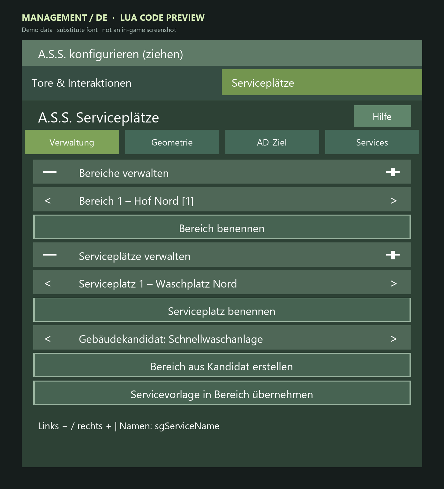

*Verwaltung: Bereich und Serviceplatz auswählen, anlegen und benennen; Kandidat und Vorlage darunter.*

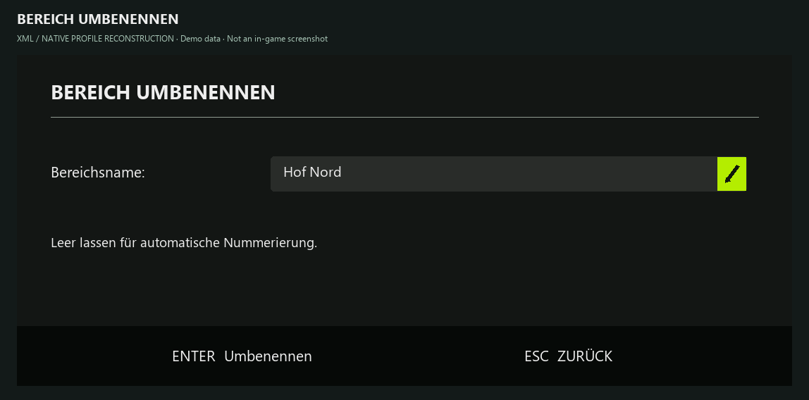

*Bereich benennen; leerer Name verwendet automatische Nummerierung. Nativer Dialogstil angenähert.*

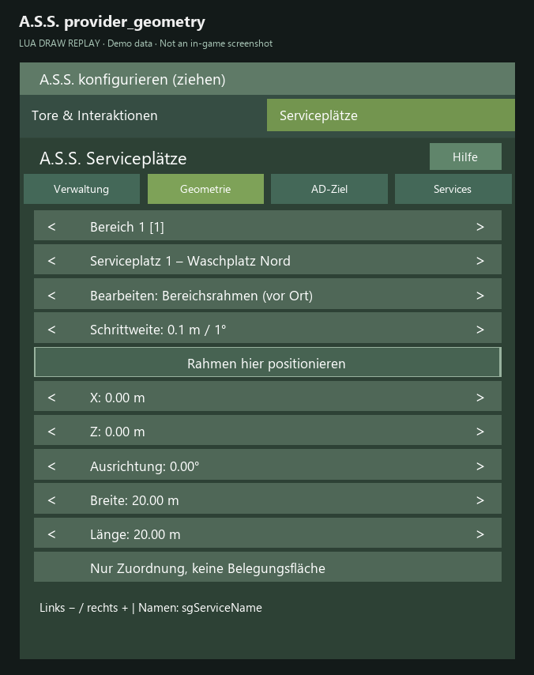

*Bearbeiten: Bereichsrahmen. Er grenzt Servicequellen ein und ist keine Belegungsfläche.*

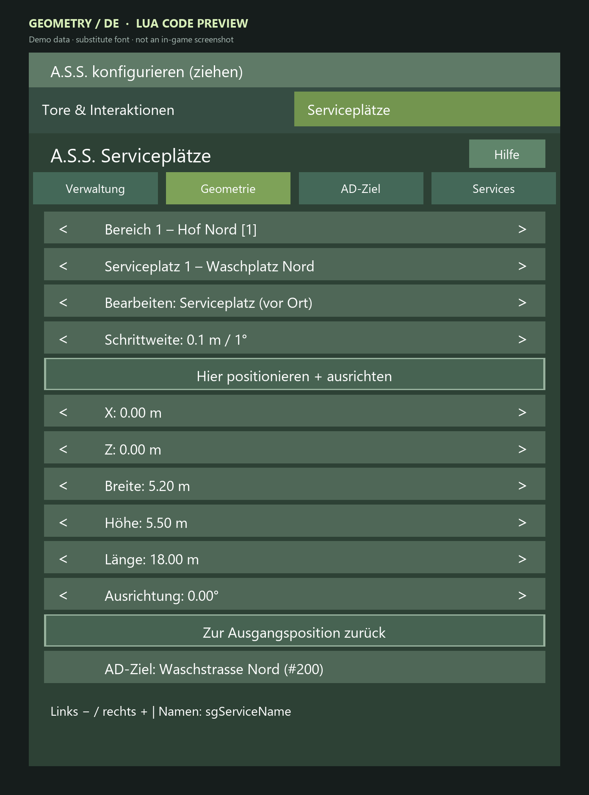

*Bearbeiten: Serviceplatz. X/Z, Breite, Höhe, Länge und Ausrichtung betreffen die gewählte Bay.*

*AD-Ziel der ausgewählten Bay: manuelle Auswahl, Suche, Aktualisierung und räumlicher Vorschlag.*

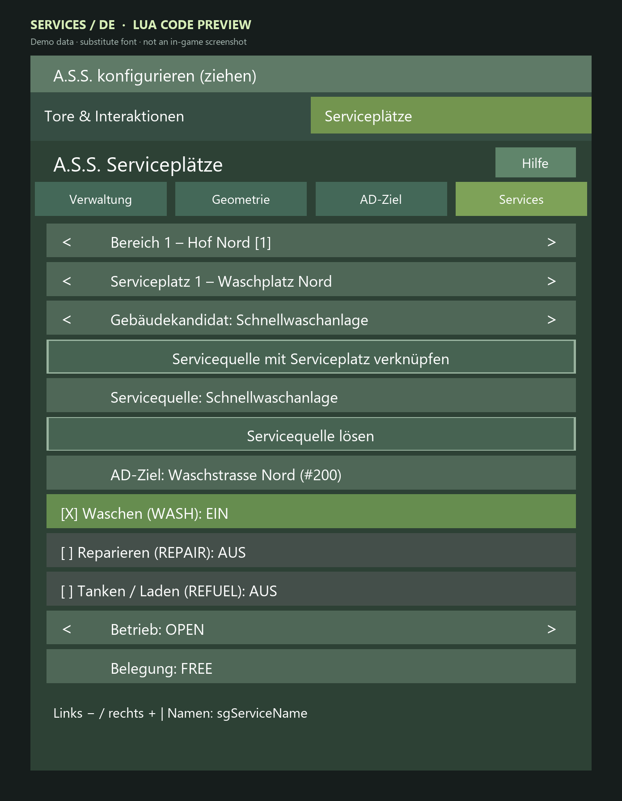

*Waschbeispiel: native Quelle verknüpft, WASH aktiv, Betrieb OPEN und Belegung FREE.*

Die Namen „Hof Nord“, „Waschplatz Nord“ und „Waschstrasse Nord“ sind Beispieldaten. In englischen Bildern dürfen Gebäudenamen deutsch bleiben: Diese Namen sind nicht automatisch übersetzte UI-Texte. Die sichtbare technische Namenshilfe `sgServiceName` stammt aus dem aktuellen Quellstand und wird nicht als Tastenbelegung empfohlen.

## 2. WASH testen

1. Verknüpfte, tatsächlich unterstützte Waschquelle und AD-Ziel konfigurieren.
2. Schmutziges, geeignetes Fahrzeug mit Berechtigung **anhalten**, ohne konkurrierenden AD-, KI-, APS- oder Serviceauftrag.
3. Im A.S.S.-Menü **Wäsche anfordern**.
4. Beobachten: Bay-Auswahl, Reservierung, AD-Anfahrt, native Waschaktion, Überprüfung des tatsächlichen Sauberkeitswerts. Je nach Auftrag werden Zyklen nur bis zum gesetzten **Ziel und Limit** wiederholt – nicht immer exakt fünf.
5. Bei ausbleibendem Effekt prüfen, ob **alle erfassten Gespannteile** vom Wirkbereich erfasst sind; sichtbare Wasch-Animation allein beweist keinen Erfolg.

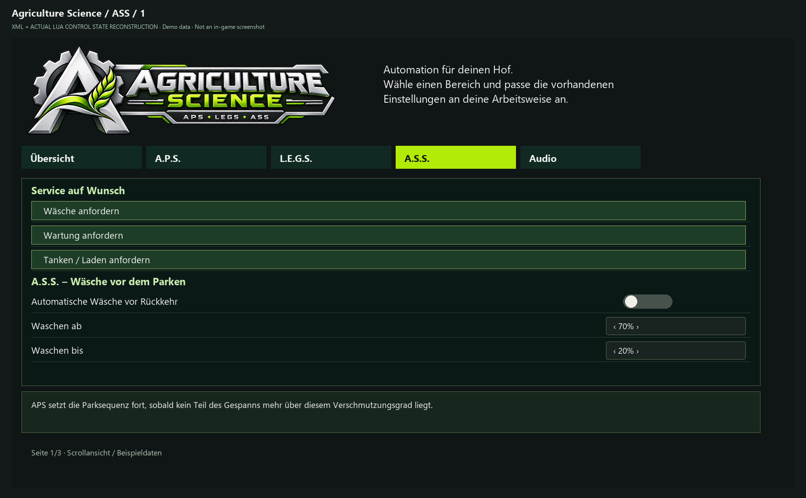

*Drei manuelle Serviceanfragen und automatische Waschoptionen auf der A.S.S.-Seite.*

## 3. REPAIR und Hebebühne

1. Native unterstützte Werkstattquelle mit entsprechender Fähigkeit verknüpfen.
2. Für **automatisch wirkende** Werkstattstationen den Interaktionsstart **AUS** konfigurieren.
3. Bei Hebebühnen passende Bühnenquelle, Verzögerung und Halteverhalten konfigurieren.
4. Geeignetes Fahrzeug anhalten und über **Wartung anfordern** eine manuelle Reparatur beginnen.
5. Prüfen: Bühne hebt erst nach passendem Halt an, **bleibt während der Reparatur gehalten**, senkt vor Abfahrt **vollständig** ab. Niemals während der angehobenen Phase manuell herausfahren.
6. Vorher/Nachher-Schaden pro relevantem Gespannteil prüfen. Die native Werkstatt kann eine Reparaturgrenze haben; **0 % Restschaden ist nicht garantiert**.

**Schwellenbegriff:** Intern **20 % Schaden** kann in der Oberfläche als **80 % verbleibender Zustand** erscheinen. Nicht „20 % Haltbarkeit“ mit dem internen Schadenswert verwechseln.

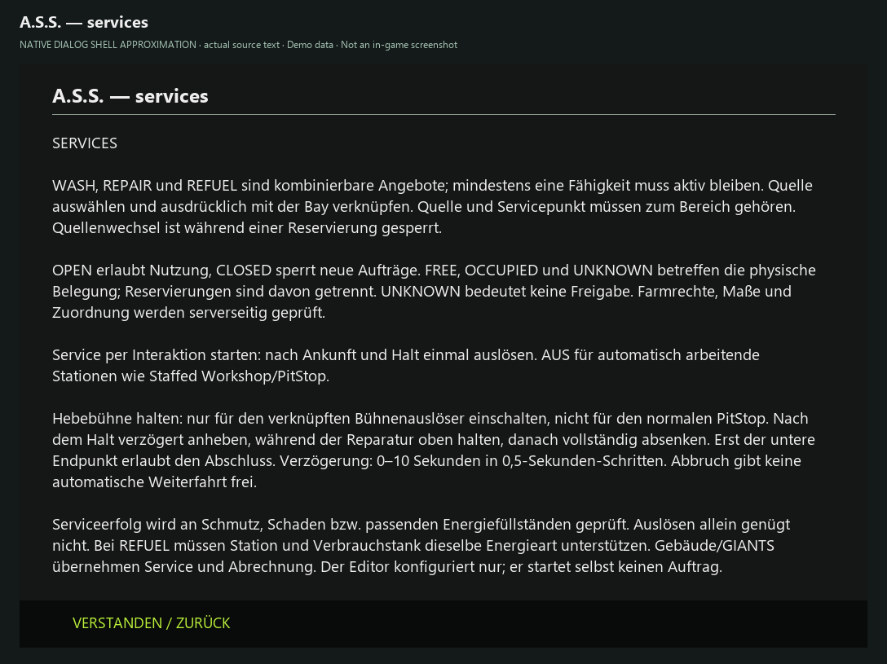

*Aktueller Hilfetext zu Fähigkeiten, automatischen Stationen, Bühnenhalten und Energiearten; Dialograhmen angenähert.*

**Noch ohne Bildnachweis:** Das konkrete verknüpfte REPAIR-Profil und die angehobene/abgesenkte Hebebühne benötigen Stations- und Ingame-Aufnahmen. Der Hilfedialog zeigt die echten Optionen, ist aber kein Nachweis eines Reparaturdurchlaufs.

## 4. REFUEL / CHARGE

1. Nur eine native, unterstützte Tank-/Ladequelle konfigurieren. Sichtbare Tankdekorationen sind keine nachgewiesenen Servicequellen.
2. Öffentliche Stationen können unterstützt sein, sofern die native Farm-/Zugriffsfreigabe dies erlaubt; private Speicher und öffentliche Quellen unterscheiden.
3. Ein geeignetes, angehaltenes Fahrzeug per Menü **Tanken bzw. Laden anfordern**.
4. Tatsächlichen Füllstand vorher/nachher kontrollieren. Unterstützte Flüssigkeiten können in **Litern**, `ELECTRICCHARGE` in **kWh** dargestellt werden.
5. **Offene Grenze:** Energieart-spezifische Bay-Vorauswahl ist nicht generell abgesichert; insbesondere Elektro-/Diesel-Bay-Zuordnung prüfen.

**Noch ohne Bildnachweis:** Es liegt keine geprüfte stationenspezifische REFUEL-/CHARGE-Konfiguration vor. Das Waschbeispiel ist keine Anleitung, einen beliebigen Tank oder eine Ladestation als kompatibel auszugeben.

## 5. Automatik und Rückkehr

Manuelle explizite Aufträge sind unabhängig von automatischen Schwellen; sie benötigen ein stehendes eigenes/berechtigtes Fahrzeug ohne laufende Fremdaufträge.

Die automatische REPAIR-/REFUEL-Bedarfserkennung sowie optionale AD-Taskwechsel-Integration sind **standardmäßig AUS**. Erst nach erfolgreichem Einzeldienst einschalten. Die Original-AD-Aufgabenfolge soll bei unterstützten sicheren Übergaben erhalten bleiben.

Nach **manuellen Menüservices** erfolgt die Rückkehr zu einem **geeigneten vorhandenen AD-Ziel innerhalb von maximal 100 m des Auslöseorts**. Es wird kein temporärer Marker erzeugt; keine punktgenaue Rückfahrt zu beliebigen Koordinaten.

**Busy Bay:** Sind alle geeigneten Bays belegt oder reserviert, wird die Anfrage abgewiesen mit Hinweis auf späteren Versuch. **Keine ausführende FIFO-Schlange, kein automatisches Nachrücken.**

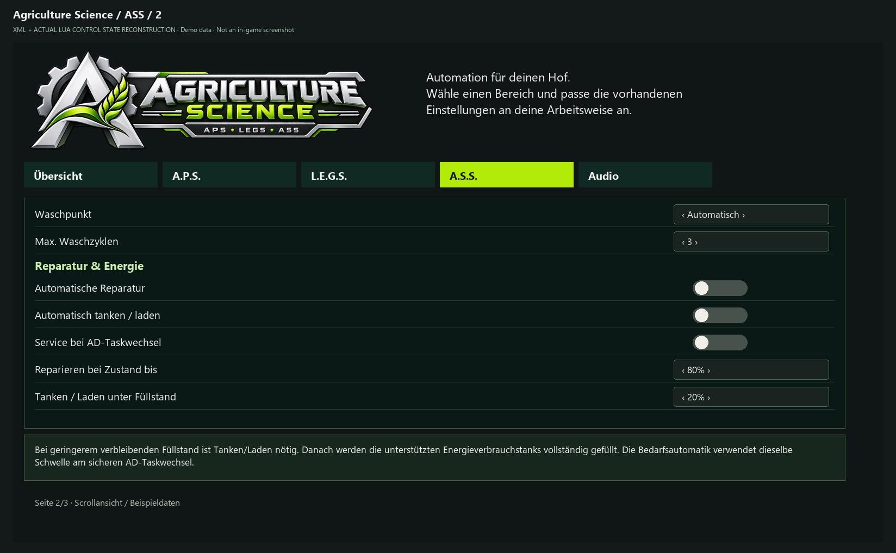

*Automatik und Schwellen: verbleibender Fahrzeugzustand und verbleibender Tank-/Ladestand.*

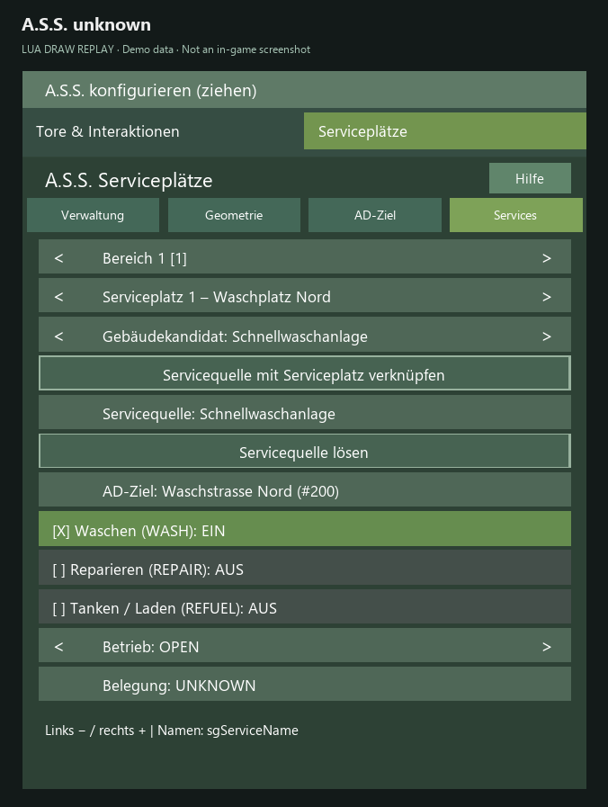

*Belegung UNKNOWN: keine Freigabe, auch wenn der Betrieb OPEN ist.*

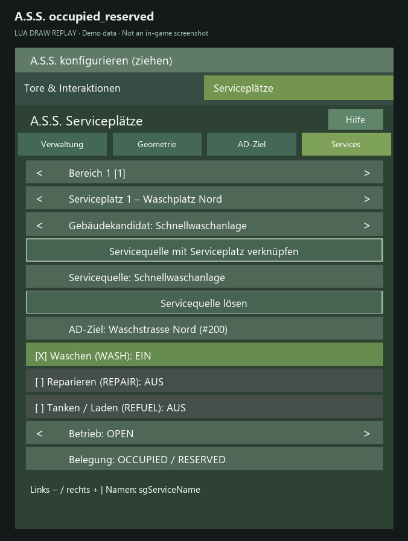

*Beispiel mit physischem OCCUPIED und zusätzlicher RESERVED-Reservierung.*

## 6. Servicebelege und Audio

Optionaler lokaler Ticketdrucker mit Animation und Geräuschen. Private Anzeige benötigt sichere Spielerzuordnung: nicht jeder unzugewiesene automatische Auftrag druckt einen Bon. Die humorvollen „durchgeführten Arbeiten“ sind **fiktive Belegpositionen**.

Bei REFUEL kann ein Bon beobachtete Mengen und einen beobachteten Farmkontostandsunterschied zeigen. Gleichzeitige Transaktionen können das Kontodelta verändern; **keine exakt isolierte Stationsrechnung** daraus ableiten.

Audio: Voice-Queue (eine Line gleichzeitig), Prioritäten, Ducking, lokale Radio-Priorität; externe Voicepacks unter `modSettings/APS_sounds/voices/` beim Update sichern. Die optionalen SPECIAL-Lines werden im aktuellen Code nach **120 Sekunden aktiver Sitzung** einmal mit **20 % Chance** geprüft, sofern gültige Clips und Bedingungen vorliegen; `Gerhard_V2` ist ausgenommen. Keine wiederkehrende 2-%-Startchance.

Weitere Hilfen: [AD-Zielmigration](MIGRATION_AD_TARGETS.md) · [Fehlerbehebung](TROUBLESHOOTING.md).

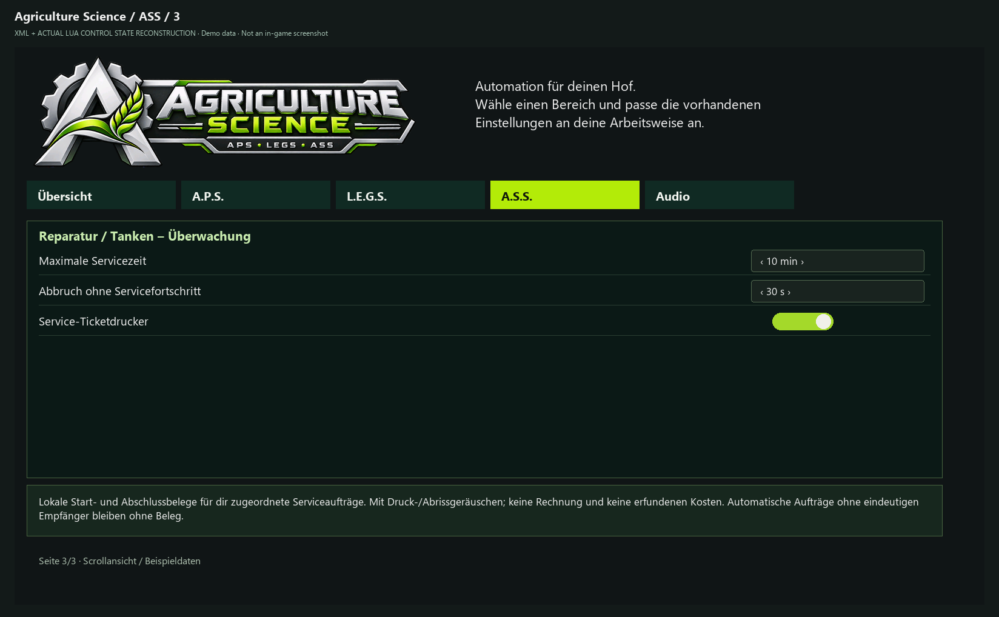

*Maximale Servicezeit, fehlender Fortschritt und optionaler lokaler Ticketdrucker.*

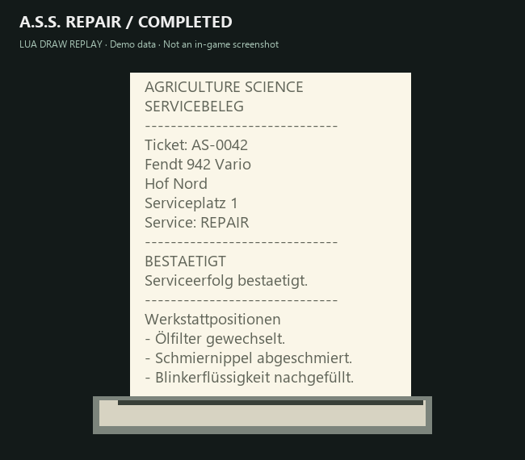

*Lokaler Abschlussbeleg für REPAIR. Werkstattpositionen sind humorvolle Texte; Beispieldaten.*

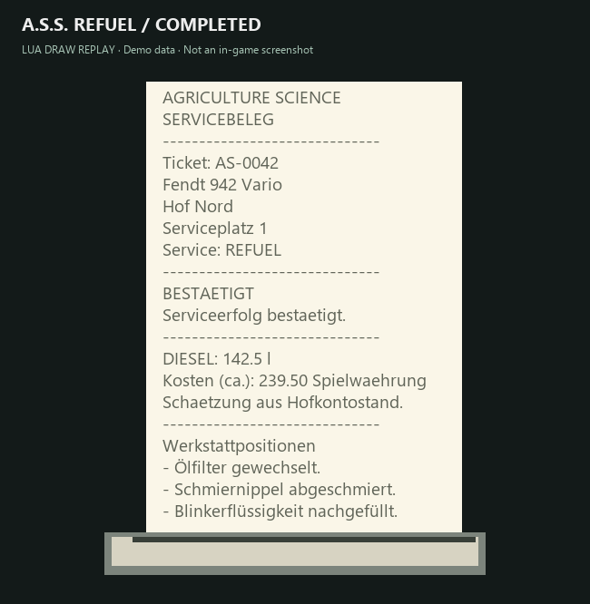

*REFUEL-Beispiel mit beobachteter Menge und geschätztem Kontodelta; keine isolierte Stationsrechnung.*
