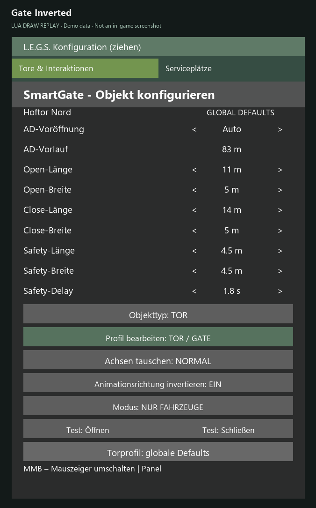
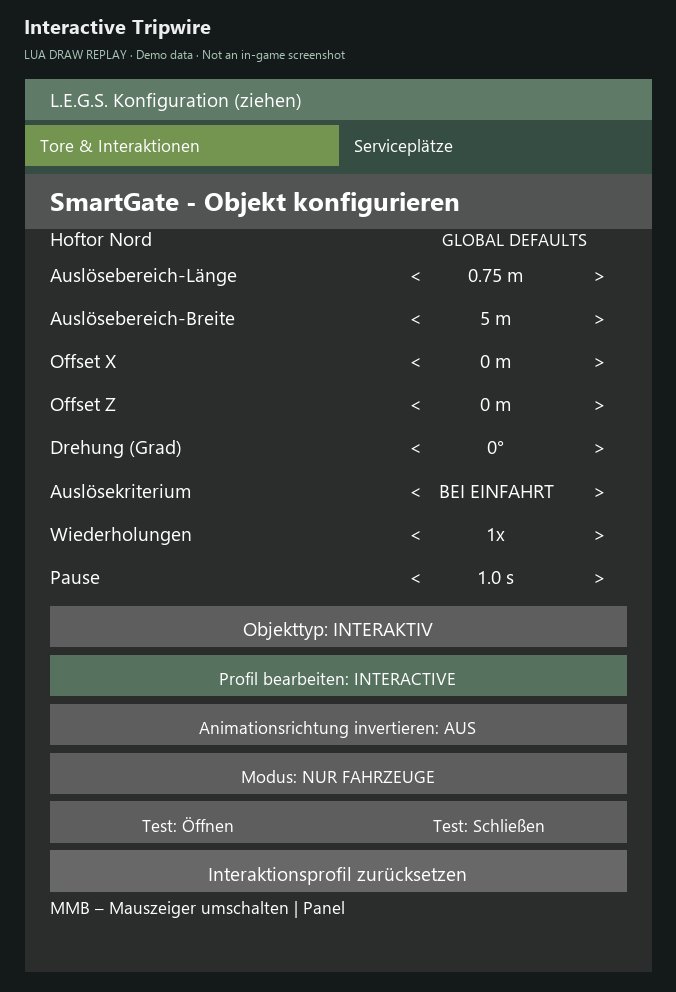
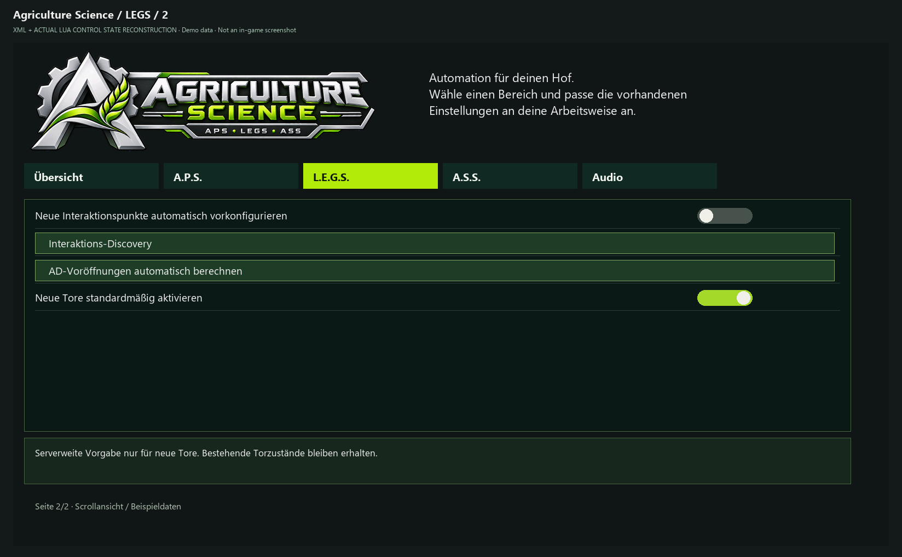

# Tutorial: L.E.G.S. – Tore, Interactables und Servicebereiche

> **Zu den Bildern:** Codebasierte UI-Abbildungen vom 29.10.2026 mit Beispieldaten, keine Ingame-Screenshots. Engine-Schrift, Farben und native Fenster können abweichen. Die Bildaufteilung der Settings ist für die Dokumentation paginiert; im Spiel wird gescrollt. [Bildnachweis und Grenzen](../UI_CATALOG.md).

L.E.G.S. wird durch **SmartGate** bereitgestellt. Basis-Torsteuerung benötigt weder APS noch AD; die optionale AD-Voröffnung setzt AutoDrive voraus.

## 1. Konfigurationsmodus öffnen

- **Strg+G:** Konfiguration aktivieren/deaktivieren (frei konfigurierbare Belegung kann abweichen).
- **Mittlere Maustaste (MMB):** **Nur im Configmodus** den Cursor umschalten.
- **Strg+Umschalt+G:** Trigger-/Bereichsvisualisierung.
- **Strg+B:** Blacklist-Verwaltung.
- Die Konfiguration ist im Fahrzeug und zu Fuß möglich. Die Oberfläche lässt sich verschieben; Hilfetexte und getrennte Seitenfunktionen beachten.

*Torprofil mit automatischer Voröffnung und Öffnen-, Schließen- und Safety-Maßen.*

## 2. Tor oder Interactable konfigurieren

1. Das erkannte Objekt auswählen; **Modus und Aktivierung** kontrollieren. Erkennung bedeutet nicht automatisch, dass ein Objekt aufgrund globaler Vorgaben aktiv ist.
2. Die Zonenvisualisierung verwenden:
   - **Cyan:** Öffnen-/Interactive-Auslösung.
   - **Violett:** Schließbereich.
   - **Rot:** Safety-/Sicherheitsbereich.
   - **Gelb-orange:** Ältere Waschboxdarstellung.
3. **Keinen separaten räumlichen „Config-Trigger“** als vierte Standardzone annehmen.
4. Logische **Animationsinvertierung** bei Bedarf setzen; sie tauscht logische Endpunkte, **nicht** die Erkennung einer Annäherung.
5. Bei Interactables/Tripwires das spezielle Verhalten vom normalen Torbetrieb unterscheiden. Safety nicht entfernen, um Schließen zu erzwingen.
6. Test mit langsamer Fahrzeuganfahrt, Durchfahrt, Stand im Safety-Bereich und anschließendem Verlassen; auf zuverlässiges Öffnen/Schließen achten.

*Schematische Draufsicht: Cyan Öffnen, Violett Schließen, Rot Safety. Keine Spielweltprojektion.*

*Animationsrichtung invertieren ist EIN; die Annäherungserkennung bleibt gleich.*

*Interactive-Profil mit Auslösung bei Einfahrt; ohne leere Erkannt-Zeile.*

Die „Erkannt“-Zeile erscheint nur bei einer brauchbaren nativen Aktionsbeschreibung. Ohne diese Beschreibung wird sie weggelassen. Das beweist keine allgemeine Objektklassifizierung.

## 3. AutoDrive-Voröffnung

Pro Objekt zwischen globalem, automatischem oder manuellem Vorlauf wählen. Die dokumentierte Automatik schätzt den Abstand aus **(Animationsdauer + 2 Sekunden) × 50 km/h**, begrenzt auf **10–500 m**. Das ist eine Näherung und keine zugesicherte tatsächliche Öffnungszeit bei jeder Geschwindigkeit. AD-Routen- und Erreichbarkeitsbedingungen prüfen.

*Manueller Vorlauf pro Tor; der gezeigte Abstand ist ein Beispielwert.*

*Globale Discovery- und Voröffnungsaktionen sowie Vorgabe für neue Tore.*

## 4. Service-Provider und Bays

Unter der Infrastruktur einen **Providerrahmen** um passende native Quellen legen; mehrere **Bays** mit eigenen Größenprofilen, Belegungs- und Reservierungszuständen sowie AD-Zielen konfigurieren.

**Drei unterschiedliche Geometrien:** Providerrahmen schränkt die Quellensuche ein, Bay-Geometrie prüft Aufstellfläche und Eignung, der **native Gebäudetrigger** bestimmt, wo der Service wirklich wirkt. Keine davon ersetzt die beiden anderen.

**Physischer Status** kann `FREE`, `OCCUPIED` oder `UNKNOWN` sein. `RESERVED` ist davon getrennte, zeitbegrenzte Reservierung. `UNKNOWN` bedeutet **nicht frei**; Hindernis prüfen, nicht Sicherheitslogik umgehen. Paletten können als Fahrzeugobjekte erscheinen und sind keine grundsätzlich zu ignorierenden Blocker.

Die Geometrieänderungen werden beim Schließen gesammelt gesichert, sofern Änderungen vorliegen. Eine synchrone neue Sicherung bei jedem Mausradschritt ist nicht das vorgesehene Verhalten.

Die vollständige Serviceplatz-Einrichtung steht im [bebilderten A.S.S.-Tutorial](TUTORIAL_ASS.md).

## 5. Zielbindung und Migration

Für den **SmartGate-Testkandidaten vom 29.10.2026** siehe [AD-Zielmigration](MIGRATION_AD_TARGETS.md). Bereits gespeicherte Zielnummern benötigen **einmalige Neuauswahl** nach Installation dieses Kandidaten, damit Name und Position als Identität gespeichert werden. Der Fix ist noch nicht nativ abgenommen.

Weiter: [ASS-Konfiguration](TUTORIAL_ASS.md) · [Fehlerbehebung](TROUBLESHOOTING.md).

