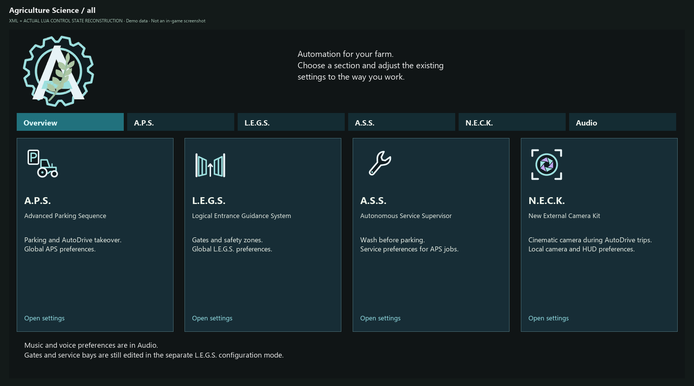
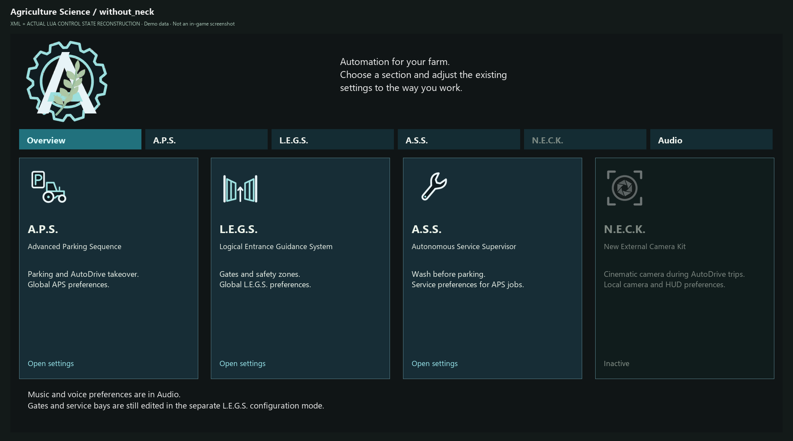

# Installation – Agriculture Science (FS25)

> **Current status: 15 November 2026 · Release in preparation.** No GitHub Release assets are published yet. This guide describes the three verified local release candidates; final approval and MP/dedicated-server tests remain pending.

## Packages

| File | Module | Version |
|---|---|---|
| `FS25_APS_AgricultureScience.zip` | **A.P.S.**, including A.S.S. | 1.0.0.0 |
| `FS25_SmartGate_AgricultureScience.zip` | **L.E.G.S.** | 1.0.0.0 |
| `FS25_NECK_AgricultureScience.zip` | **N.E.C.K.** | 0.1.0.0 |

**Install AutoDrive separately:** A.P.S. and N.E.C.K. declare `FS25_AutoDrive` as a required dependency in their `modDesc.xml`. AutoDrive **3.0.1.4** is the reference used, not a proven minimum. L.E.G.S. can be used on its own. A.S.S. service features require **both A.P.S. and L.E.G.S.** Courseplay is optional.

## New installation

1. Fully exit FS25; back up your savegame and existing mods.
2. Once approved, download the desired **individual mod ZIPs** from [GitHub Releases](https://github.com/The-0kami/FS25_AgricultureScience/releases). GitHub's automatically generated source archive is **not an installable game mod**.
3. Extract an optional outer *Complete* bundle first. **Do not extract the inner mod ZIPs.**
4. Copy the individual unchanged ZIPs to your active FS25 mods folder. Remove older duplicates.
5. Install AutoDrive separately, enable the required mods for your savegame and check their menus and functions.

### Module availability in game

*Code-based GUI preview with demo data.*

**All three mod packages are loaded**

**N.E.C.K. is unavailable in this session**

## Updates and servers

Back up `smartGate.xml` and your AutoDrive destinations before updating. Older LEGS service bays with numeric AutoDrive destinations may require reselecting the destination: [migration guide](MIGRATION_AD_TARGETS.md). On MP/dedicated servers use **byte-identical mod ZIPs** on all clients and the server; verify SHA-256 rather than relying only on the version string. Full current dedicated-server end-to-end testing remains pending.

## Setup and support

[A.P.S. tutorial](TUTORIAL_APS.md) · [A.S.S. tutorial](TUTORIAL_ASS.md) · [L.E.G.S. tutorial](TUTORIAL_LEGS.md) · [Troubleshooting](TROUBLESHOOTING.md) · [Compatibility](../COMPATIBILITY.md)

**About earlier illustrations:** The UI images from 29 October 2026 are code-generated previews, not in-game screenshots. The new 15 November DE/EN UI previews are being prepared separately for the GitHub documentation.
