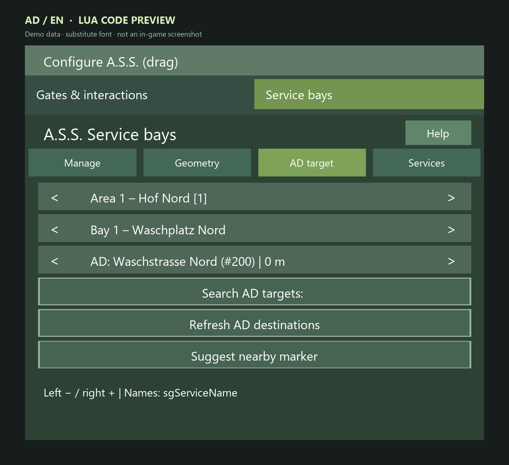

# Migration: AD service destinations after marker changes

> **About these images:** Source-derived UI illustrations dated 29 October 2026 with demo data, not in-game screenshots. Engine fonts, colors and native windows may differ. Settings are split into readable pages for documentation; the game uses scrolling. [Image provenance and limitations](../UI_CATALOG.md).

> **IMPORTANT – 29 October 2026:** Target identity is included in successor `SG_InteractionDescription_20261029`. It has been installed locally and verified by SHA-256; native in-game/Dedi verification of the new fix is still pending. Local installation does not update a remote server.

## Background

The previous bay AD destination number was a **mutable list position**, not a stable identity. Deleting a **preceding destination** can shift later indices; the saved bay number could then lead to a different location. In one user's case, destination `320` now led to a **pea storage** destination. The index defect was reproduced using real readable AD functions, but **the particular prior edit/import that triggered the user's case is not proven**. In the examined case, merely adding a destination appended it and did not shift existing indices.

## Behavior of the new candidate

- Deliberate selection records **index, name and X/Z coordinates**.
- Verifies identity **every ten seconds** and **before use** against live AD data.
- If the index changes, finds a replacement only by an unambiguous match of **both name and position**.
- Missing, ambiguous, renamed or moved destinations become **UNKNOWN**, with no unsafe dispatch.
- Identity loss during a journey revokes the lease and invokes existing **cleanup/cancellation** instead of silently rerouting.
- Stale client clicks are rejected server-side; index correction adds no synchronous file save.

## One-time re-selection after installing the candidate

1. Stop the game/server and back up the savegame including **`smartGate.xml`**.
2. When testing is authorized, ensure **server and all clients run the identical new SmartGate build**.
3. Load the game, then open each **A.S.S. service bay** in LEGS.
4. Refresh the list on the **AD Destination** page.
5. **Deliberately re-select each previously saved positive bay destination once.** This records reliable name/position identity. Do not silently accept a potentially stale old index.
6. Verify the marker really approaches the **correct bay**. An existing destination is not a route test.
7. Save changes and run one controlled test drive, checking the current log.
8. If a marker is later **deleted, renamed or moved**, blocking it as UNKNOWN may be intentional. Select its updated destination explicitly.

**Preserved:** Provider and bay regions, linked native sources, dimensions and capabilities. The full bay setup need not be recreated.

*Selected bay AD target: manual selection, search, refresh and nearby-marker suggestion.*

## If dispatch is refused

- UNKNOWN and blocked dispatch may be **correct safety behavior**, not proof of a new path error.
- Check build/hash, deliberate re-selection, destination name/coordinates, uniqueness and the actual AutoDrive route.
- Capture fresh job/lease information and a redacted server log if cancellation happens mid-drive.
- Do not claim a specific historical AD edit caused the earlier issue unless confirmed.

See [build status](../BUILD_STATUS.md) · [troubleshooting](TROUBLESHOOTING.md).

