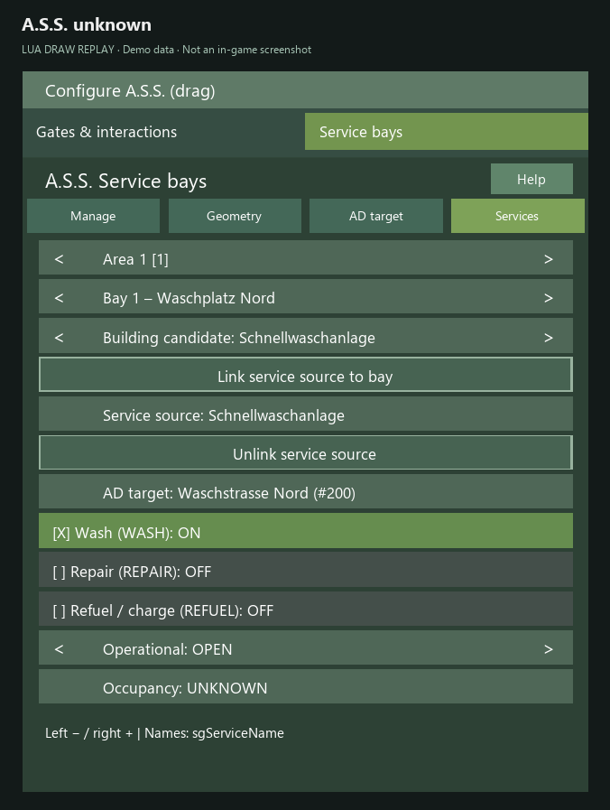

# Troubleshooting and bug reports

> **About these images:** Source-derived UI illustrations dated 29 October 2026 with demo data, not in-game screenshots. Engine fonts, colors and native windows may differ. Settings are split into readable pages for documentation; the game uses scrolling. [Image provenance and limitations](../UI_CATALOG.md).

Identify mod ZIPs by **SHA-256**, not only their shared `1.0.0.0` version. See [build matrix](../BUILD_STATUS.md). Record LS25/AD versions, SP/Host/Dedi, vehicle/attachments, job context and a fresh redacted log.

| Symptom | First checks |
|---|---|
| **Driving to the wrong service destination** | Check the actual SG build, current AD list and saved bay target. In the **29 October identity candidate and its successor**, **re-select existing positive targets once** to capture name/position identity. See [migration](MIGRATION_AD_TARGETS.md). |
| **No eligible provider/source** | Verify supported native source, provider volume, farm access, `OPEN`, energy type and actual trigger. Decorative tanks are not valid sources; public stations still require native permission. |
| **Bay UNKNOWN** | UNKNOWN is conservative, **not FREE**. Check geometry, local objects/pallets, tipped bodies and occupancy. Do not attribute remote vehicles without evidence or ignore genuine local obstacles. |
| **Bay busy/reserved** | Distinguish physical `OCCUPIED` from separate `RESERVED` lease. Retry later: **no active executing service queue** exists. |
| **Service animates but has no effect** | Verify native effect area covers every relevant unit. Animation alone does not prove cleaning, repairing or refueling. On lifts check full lowering before departure. |
| **AD marker exists but driving fails** | Verify AD connections and actual navigable route; a marker is not route proof. |
| **Parking does not resume after warning** | Collect **fresh server log** with job/request IDs and AD path errors; an older unresolved failure is not considered universally fixed. |
| **Missing ticket or voice line** | Check local audio/receipt settings, safe player/session identity and available clips. Unattributed automatic tasks need not generate private presentation. |
| **Old voice file persists after update** | External packs under `modSettings/APS_sounds/voices/` are not overwritten indiscriminately; back up personalized files before replacement. |
| **Controller cannot operate all service editor controls** | Shared Agriculture Science settings have controller support, but the separate **in-world service editor** remains partially non-controller-operable. |

## Bug-report checklist

- FS25/AutoDrive versions and exact **APS/SG SHA-256 hashes**.
- Single-player, hosted MP or dedicated server; identify relevant local/remote context.
- Vehicle model, attachments, damage/fill levels.
- Provider/bay geometry, capabilities, linked sources, AD destination and occupancy.
- Exact steps, expected/observed behavior.
- **Fresh**, privacy-redacted `log.txt` with relevant job/request IDs.
- For the new destination identity scheme: was the AD destination explicitly re-selected after installation?

Automated regression results are **not** evidence of native in-game or Dedi success. Do not present hypotheses as established causes.

*UNKNOWN occupancy: not available, even when operational state is OPEN.*
