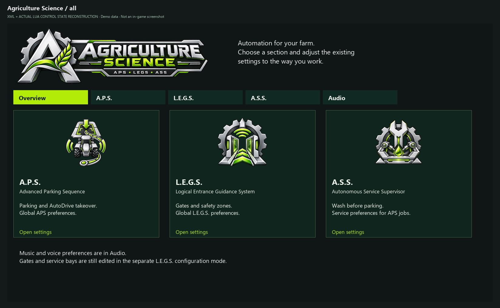
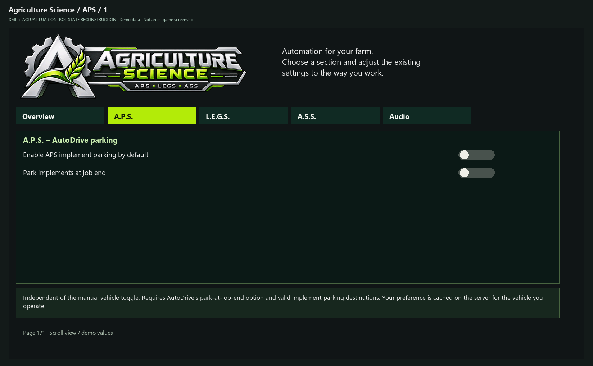
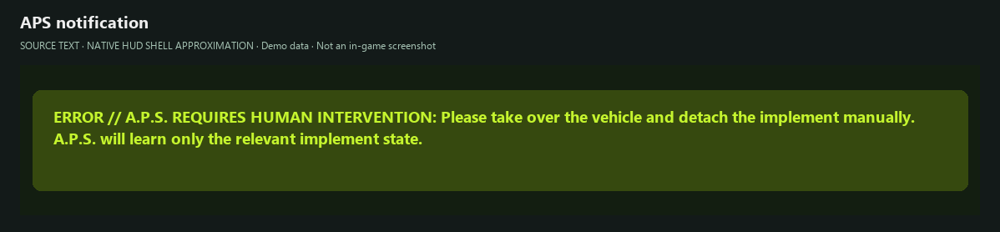

# Tutorial: A.P.S. – Advanced Parking Sequence

> **About these images:** Source-derived UI illustrations dated 29 October 2026 with demo data, not in-game screenshots. Engine fonts, colors and native windows may differ. Settings are split into readable pages for documentation; the game uses scrolling. [Image provenance and limitations](../UI_CATALOG.md).

APS coordinates parking for a tractor/truck and **up to two suitable directly attached implements**. AutoDrive handles navigation; APS controls the sequence and respects native detaching rules. ASS is bundled in the APS ZIP, while services additionally require LEGS.

*Agriculture Science overview with three available module cards.*

## 1. Preparation

1. Build and verify **driveable AutoDrive routes** to the vehicle parking marker and to every required implement marker.
2. Assign the correct **AD parking destinations** to the vehicle and each implement. APS will not invent missing destinations.
3. Start with one ordinary tractor and **one** implement. Test turntable trailers, folded equipment and longer combinations later.
4. Open **Agriculture Science → A.P.S.** and configure the desired manual and supported job-end parking options.

*Global A.P.S. implement-parking and job-end takeover options.*

## 2. Starting a parking sequence

- **Ctrl+P** is the documented **rebindable start action**. It is not a generic start/cancel toggle, and user bindings may differ.
- Existing AutoDrive HUD integration includes a cancellation path via **Shift + right-click** on the APS-enhanced parking button, unless another HUD action conflicts.
- APS validates assignments, drives to the first implement destination, detaches using **native game conditions**, optionally parks the next suitable implement, then drives to the vehicle's parking target.
- Some implement configurations use a teach/learning path. Compatibility with every modded implement is not promised.

*Manual teaching required: actual message text in an approximated notification surface.*

**Image gap:** AD parking-target assignment and the APS-enhanced AD parking button are not illustrated here. Verified native screenshots are still needed; the notification is not a full teaching walkthrough.

## 3. Optional services before parking

1. First validate a **parking-only** run.
2. Configure a supported bay in **LEGS**, including native source, geometry and AD destination.
3. Enable WASH and/or desired automatic service checks in the **A.S.S.** page. Automatic REPAIR/REFUEL checks and AD-task-change interception are **OFF by default**.
4. Interpret thresholds carefully: repair logic may use damage internally while the UI shows **remaining condition** (e.g. 20% damage = 80% condition). Refuel threshold represents remaining fuel/charge.
5. Start another APS job. Supported service execution is inserted before parking and, if successful, the original process resumes. Missing sources, bays or routing do not imply completion.

## 4. Validation and troubleshooting

Observe an SP run without manually moving the vehicle. Verify actual native detaching and travel to the vehicle's final destination. Test weights and multi-unit trains separately.

**Experimental resume extension:** Installed APS currently includes a resume attempt addressing certain stalls after turntable detaching/service. Positive SP reports exist but **no broad Dedi approval**. The canonical APS export does **not** contain this extension.

If parking stops unexpectedly, record vehicle, attachments, AD destinations, job context and a **fresh server log**. An older failure following a service-unavailable warning is not considered universally fixed.

See [ASS](TUTORIAL_ASS.md) and [troubleshooting](TROUBLESHOOTING.md).

