# Tutorial: A.S.S. – Autonomous Service Supervisor

> **About these images:** Source-derived UI illustrations dated 29 October 2026 with demo data, not in-game screenshots. Engine fonts, colors and native windows may differ. Settings are split into readable pages for documentation; the game uses scrolling. [Image provenance and limitations](../UI_CATALOG.md).

ASS is **bundled inside the APS ZIP**; there is no separate ASS mod ZIP. **Both APS and LEGS/SmartGate** must be loaded for service execution. AutoDrive navigates, LEGS provides service infrastructure, and ASS coordinates native actions. ASS does **not** replace native station payment or fuel systems.

## 1. Configure a service bay

1. Open the separate configuration mode with **Ctrl+G** and select **Service bays**. Global options and service requests are in the shared **Agriculture Science → A.S.S.** settings tab. The in-world service editor uses **Management / Geometry / AD Destination / Services** sections (localized labels may differ); unavailable module views are disabled.
2. Identify a supported building with a verifiable native service source. A building's appearance alone is insufficient.
3. Place the **provider volume** around the intended service sources without unintentionally including neighboring buildings.
4. Position and orient **bay geometry** separately. Bay height extends **upward from its base**. Drag the header to move the panel; the mouse wheel over geometry fields adjusts values, with documented accelerated steps.
5. Enable at least one capability: WASH, REPAIR or REFUEL; supported combinations are possible. A capability flag never substitutes for a real native source.
6. Refresh the **AD destination** list and deliberately select the correct stop, or verify a spatial suggestion. An AD marker **does not prove routing is driveable**. Do not expect a second destination field.
7. Close/save geometry changes. Check provider **OPEN**, physical bay state **FREE**, no foreign reservation. Investigate **UNKNOWN** rather than overriding it.
8. Test **one manual service** before enabling automatic checks.

**Three separate areas:** provider volume limits source discovery; bay geometry establishes physical suitability/occupancy; the **native building trigger** is where service actually happens. All relevant tractor/attachment units must receive the real effect. Do not enlarge boxes merely to bypass suitability checks.

### Illustrated setup workflow

Open the separate configuration mode with **Ctrl+G** and select **Service bays**. The A.S.S. card in the main menu contains global options and requests; it is not the spatial editor. Custom bindings may differ.

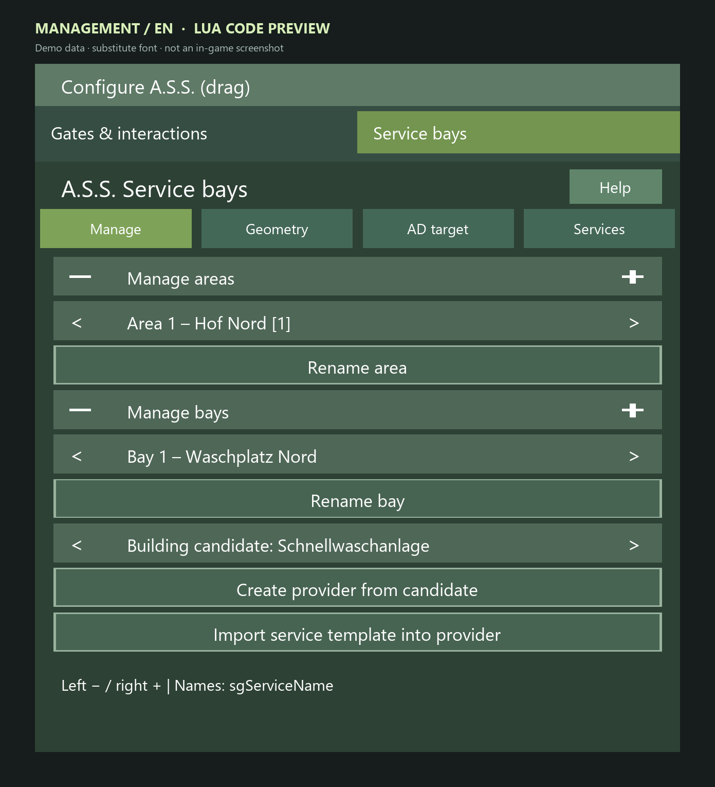

*Management: select, create and name areas and bays; candidate and template actions below.*

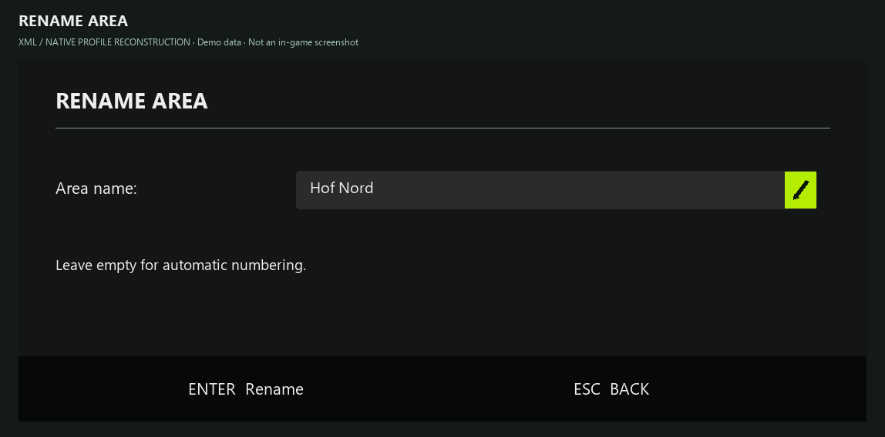

*Rename an area; an empty name uses automatic numbering. Native dialog styling approximated.*

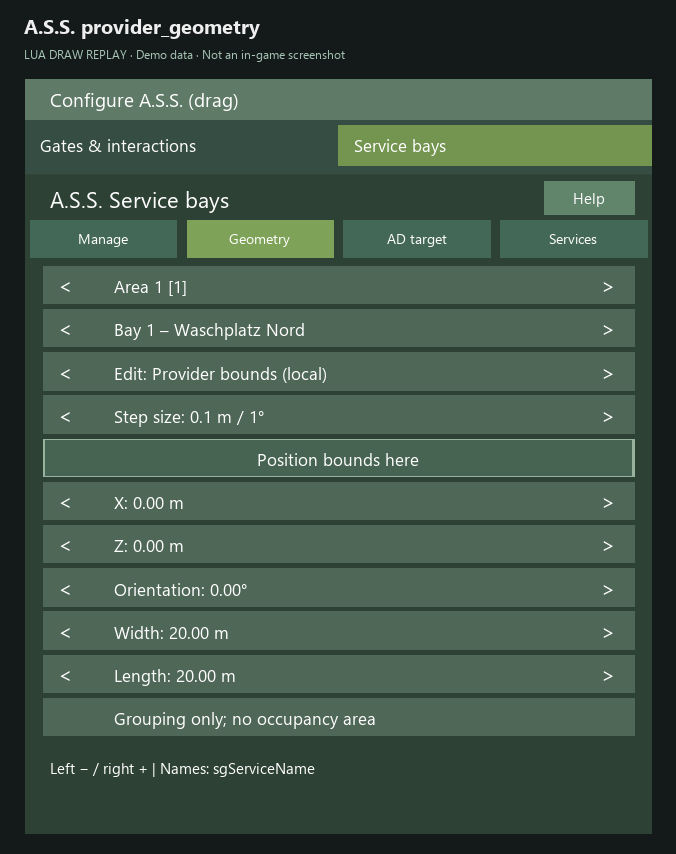

*Edit: provider bounds. This limits source selection and is not the bay occupancy area.*

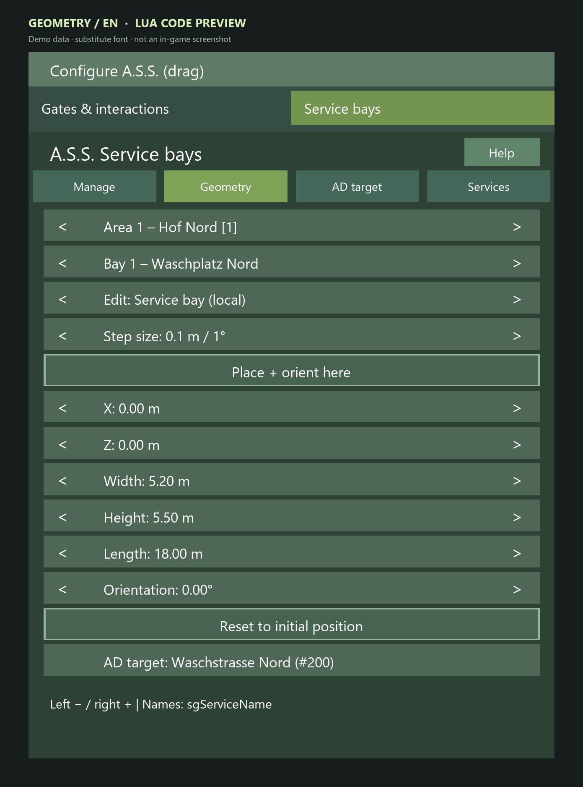

*Edit: service bay. X/Z, width, height, length and orientation apply to the selected bay.*

*Selected bay AD target: manual selection, search, refresh and nearby-marker suggestion.*

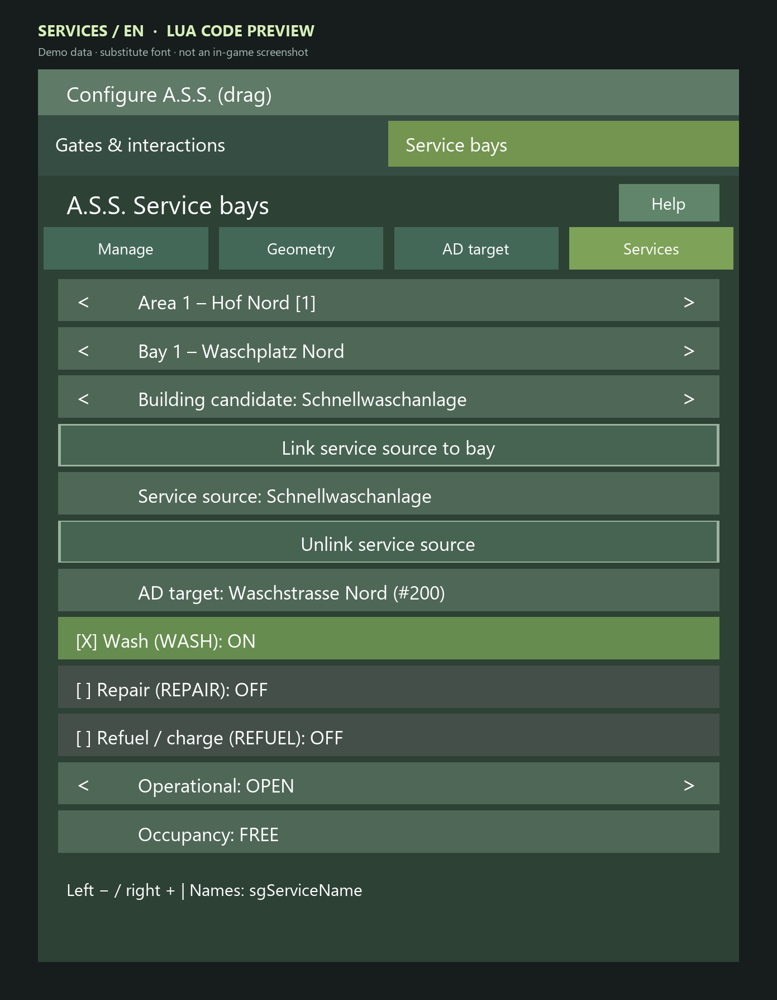

*Wash example: native source linked, WASH enabled, operational OPEN and occupancy FREE.*

“Hof Nord”, “Waschplatz Nord” and “Waschstrasse Nord” are demo names. Building names may remain German in English views; user/source names are not automatically translated UI labels. The visible technical name hint `sgServiceName` comes from the current source and is not a recommended key binding.

## 2. WASH

1. Configure a supported linked wash source and AD destination.
2. Stop a suitable authorized vehicle, with no competing AD, AI, APS or service job.
3. Choose **Request wash** in the ASS menu.
4. Observe bay selection, reservation, actual arrival, native washing and **measured cleanliness**. Cycles continue only up to that job's **goal and limit**; exactly five cycles are not universally required.
5. If cleaning does not register, check the native effect area for every attached unit. A completed animation alone is not proof.

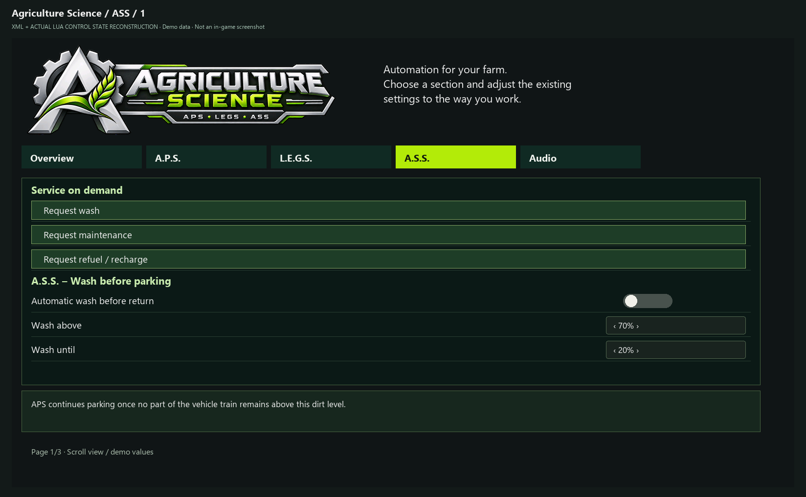

*Three manual service requests and automatic wash options on the A.S.S. page.*

## 3. REPAIR and vehicle lifts

1. Link a supported native workshop source with REPAIR capability.
2. For workshops that act **automatically**, configure interaction start **OFF**.
3. If using a lift, configure the correct native lift source, holding behavior and suitable delay.
4. Stop an authorized vehicle and use **Request maintenance**.
5. Verify the lift raises after the correct stop, **remains raised while repairing**, and comes **fully down before departure**. Do not manually drive off a raised lift.
6. Compare actual damage on each relevant unit. Native repair limits may prevent precisely zero remaining damage.

**Threshold wording:** An internal **20% damage** threshold may display as **80% remaining condition**. Do not describe the former as “20% durability.”

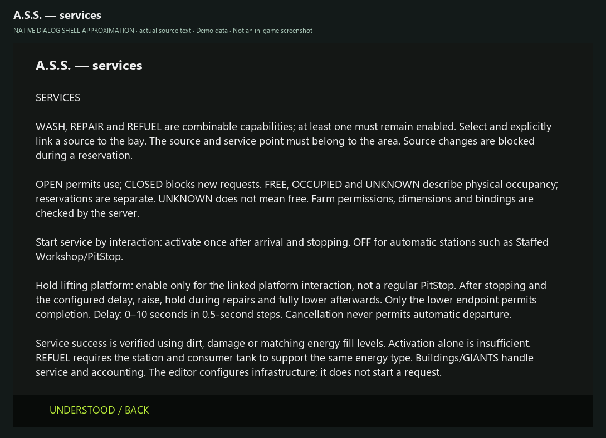

*Current help for capabilities, automatic stations, lift holding and energy types; dialog shell approximated.*

**Still missing:** A concrete linked REPAIR profile and raised/lowered lift require station-specific native captures. The help dialog describes actual options but does not prove a completed repair.

## 4. REFUEL / CHARGE

1. Link a genuinely supported native filling/charging trigger; decorative tanks do not count.
2. Public sources may be supported when native farm-access rules allow; distinguish public providers from private storage and decorations.
3. Stop an eligible vehicle and choose **Request refuel/charge** from the menu.
4. Verify actual fill level before and after. Supported fluids can be expressed in **litres**, `ELECTRICCHARGE` in **kWh**.
5. **Known limitation:** Energy-type-specific bay pre-selection is not comprehensively guaranteed, particularly for electric versus diesel bays.

**Still missing:** No verified station-specific REFUEL/CHARGE configuration is pictured. The wash example does not certify an arbitrary tank or charging station as compatible.

## 5. Automatic checks and return

Explicit manual requests do not require an automatic threshold to be reached; they do require an eligible stopped and authorized vehicle with no competing activity.

Automatic REPAIR/REFUEL checks and optional AD-task-change interception are **OFF by default**. Enable them only after manual tests. Supported interception should preserve the original AD task sequence.

After a **manual menu service**, the vehicle returns to an **existing suitable AD destination within at most 100 m of the original request location**. No temporary marker is created, and exact world-coordinate return is not promised.

**Busy bays:** If every matching bay is occupied/reserved, the request is declined with a retry-later notice. There is **no executing FIFO queue or physical waiting area**.

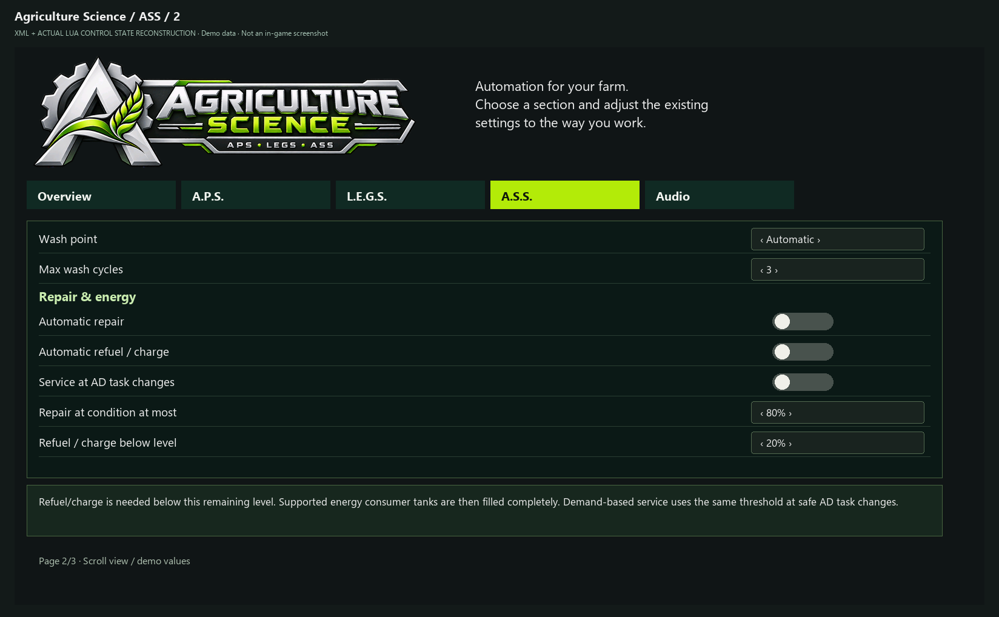

*Automation and thresholds: remaining vehicle condition and remaining fuel or charge.*

*UNKNOWN occupancy: not available, even when operational state is OPEN.*

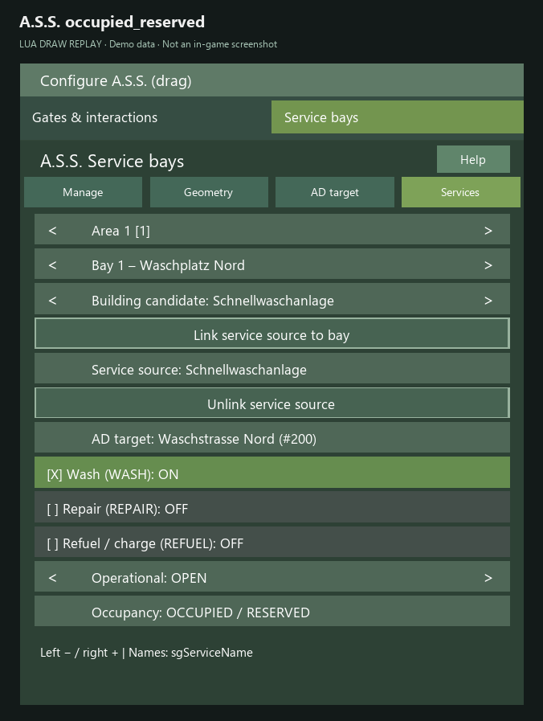

*Example showing physical OCCUPIED plus a separate RESERVED reservation.*

## 6. Receipts and audio

Optional locally presented receipts use printer animation and effects. A private receipt requires safe player attribution; not every unassigned automatic job creates one. Humorous “work performed” items are **fictional display text**.

REFUEL receipts may include observed quantities and an observed change in farm balance. Concurrent transactions can affect that balance, so it is **not a verified station-item invoice**.

Audio includes a one-at-a-time voice queue, priorities, ducking and local radio priority. Back up external voicepacks in `modSettings/APS_sounds/voices/` before updating. Current SPECIAL logic makes a **single attempt after 120 seconds of active session with 20% chance**, if valid clips and guards exist; `Gerhard_V2` is exempt. Do not describe an older 2% startup chance.

See [AD destination migration](MIGRATION_AD_TARGETS.md) and [troubleshooting](TROUBLESHOOTING.md).

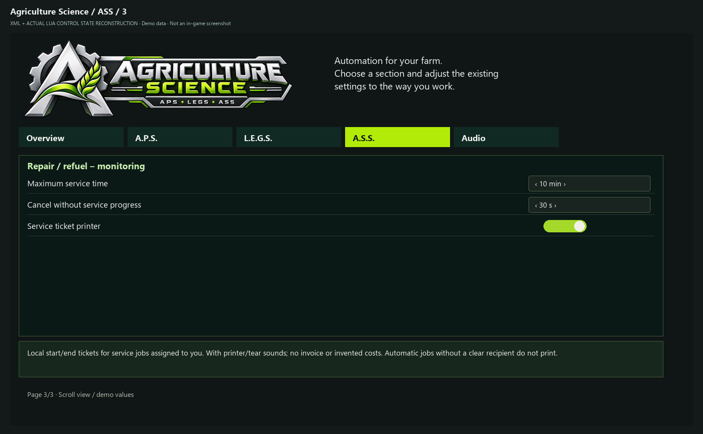

*Maximum service time, no-progress limit and optional local ticket printer.*

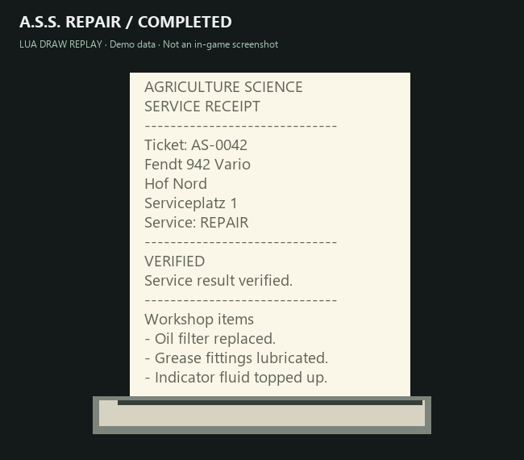

*Local completed REPAIR receipt. Workshop items are humorous text; demo data.*

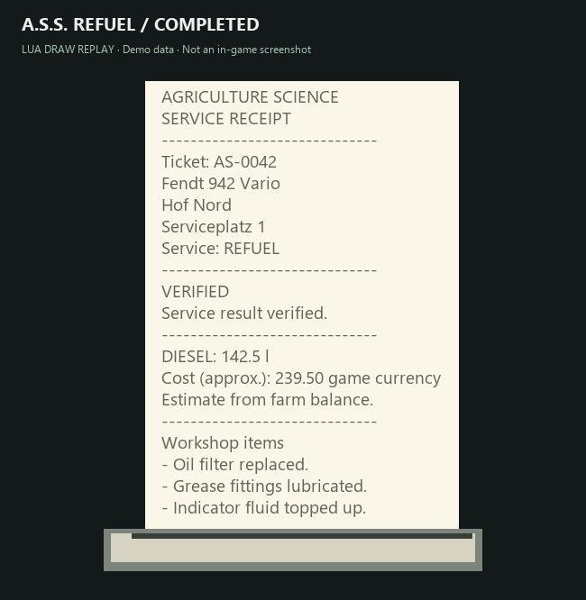

*REFUEL example with observed quantity and estimated balance delta, not an isolated station invoice.*
