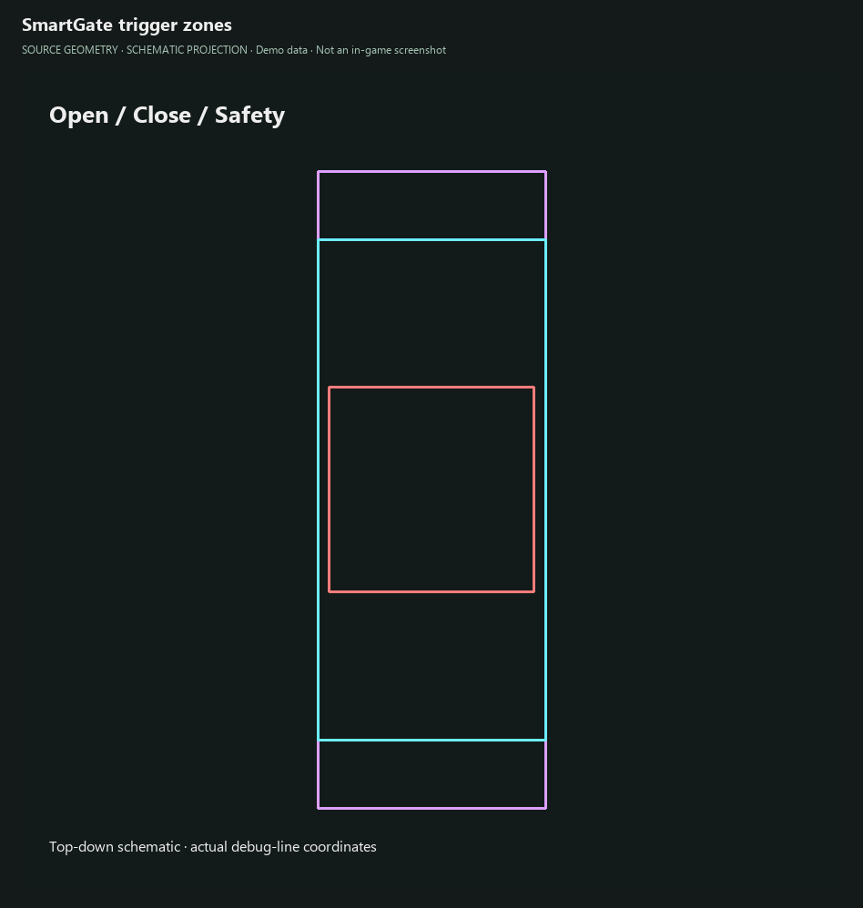
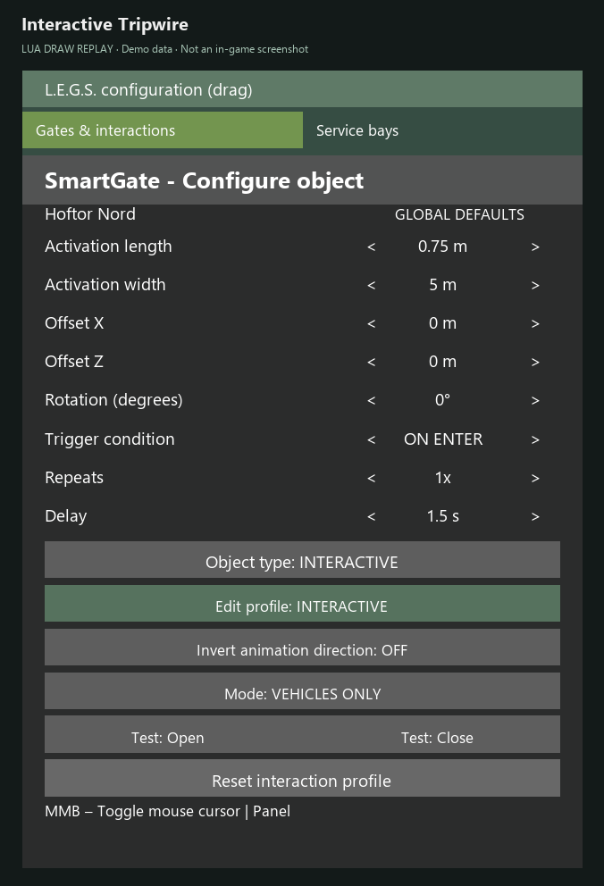
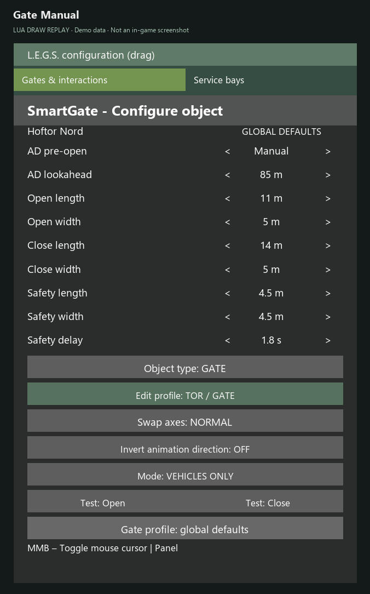
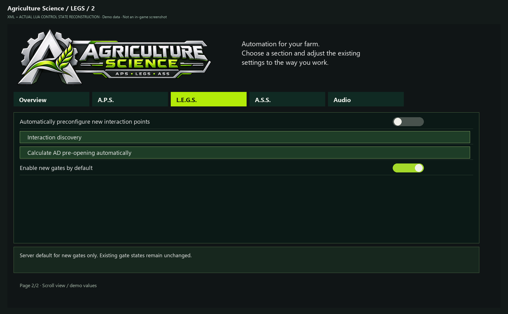

# Tutorial: L.E.G.S. – gates, interactables and service areas

> **About these images:** Source-derived UI illustrations dated 29 October 2026 with demo data, not in-game screenshots. Engine fonts, colors and native windows may differ. Settings are split into readable pages for documentation; the game uses scrolling. [Image provenance and limitations](../UI_CATALOG.md).

LEGS is delivered in **SmartGate**. Basic gate control works without APS or AutoDrive; optional AD pre-opening requires AutoDrive.

## 1. Enter configuration mode

- **Ctrl+G:** enable/disable configuration (custom key bindings may differ).
- **Middle mouse button (MMB):** toggle cursor **only while configuration mode is active**.
- **Ctrl+Shift+G:** trigger/area visualization.
- **Ctrl+B:** blacklist controls.
- Configuration works on foot and in a vehicle. The panel is movable and provides page-specific help.

*Gate profile with automatic pre-opening and opening, closing and safety dimensions.*

## 2. Configure a gate or interactable

1. Select the detected object and verify its **mode and enabled state**. Detection alone does not guarantee activation under the global defaults.
2. Inspect colored visualization:
   - **Cyan:** opening / interactable activation.
   - **Purple:** closing region.
   - **Red:** safety region.
   - **Yellow-orange:** legacy wash-box representation.
3. Do **not** assume a separate spatial “configuration trigger” still exists as a fourth standard region.
4. Set **animation inversion** only if needed: it swaps logical animation endpoints, **not** approach detection.
5. Distinguish interactable/tripwire behavior from regular gates. Never remove safety merely to force closing.
6. Test low-speed approach, crossing, stopping inside safety and moving away.

*Schematic top view: cyan opening, purple closing, red safety. Not a world-space game view.*

*Animation direction is inverted; approach detection is unchanged.*

*Interactable profile triggered on entry, without an empty Detected row.*

The Detected row appears only when a useful native action description exists. Otherwise it is omitted; it does not certify the object classification.

## 3. AutoDrive pre-opening

Choose global, automatic or manual pre-opening per gate. The documented automatic estimate is **(animation duration + 2 seconds) × 50 km/h**, clamped to **10–500 m**. This estimates distance and does not guarantee opening timing at every real speed; route conditions matter.

*Per-gate manual lookahead; the shown distance is a demo value.*

*Global discovery, pre-opening action and default activation of new gates.*

## 4. Service providers and bays

Place a **provider volume** around the intended native sources. Configure one or more individually named **bays** with size profiles, AD destinations, occupancy and reservations.

**Three distinct regions:** provider volume restricts eligible source discovery; bay geometry determines physical fit/occupancy; the **native building trigger** determines where the service actually applies. These cannot be treated as interchangeable.

Physical state can be `FREE`, `OCCUPIED` or `UNKNOWN`. `RESERVED` is a **separate time-limited reservation**, not a physical state. `UNKNOWN` does **not** mean clear. Inspect genuine local obstacles; pallets may belong to GIANTS' vehicle system and must not be ignored by default.

Geometry changes are batched and saved on closing the editor if changes occurred; there should not be a synchronous save for every mouse-wheel step.

See the [illustrated A.S.S. tutorial](TUTORIAL_ASS.md) for the complete service-bay workflow.

## 5. AD target migration

For the **SmartGate candidate dated 29 October** see [AD destination migration](MIGRATION_AD_TARGETS.md). Existing numeric destination assignments must be **re-selected once** after installing that candidate to record name and coordinates. The new fix is not yet verified in-game.

Continue with [ASS setup](TUTORIAL_ASS.md) and [troubleshooting](TROUBLESHOOTING.md).

